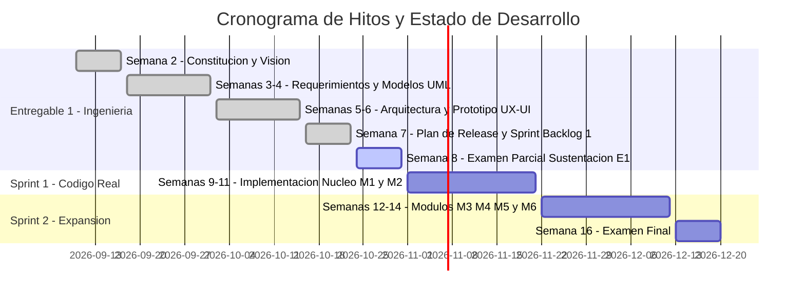

# Sistema de Gestión de la Clínica San Rafael — SIGES SR

[-blue.svg)](#-estado-actual-del-proyecto)
[](https://fiis.uni.edu.pe/)
[](#-arquitectura-y-stack-tecnol%C3%B3gico)
[](#)

Repositorio oficial del **Proyecto Integrador (Parte 1)** para el curso **Taller de Ingeniería de Software I (SW705)** — Facultad de Ingeniería Industrial y de Sistemas (FIIS), Universidad Nacional de Ingeniería (UNI).

---

## 👥 Equipo de Desarrollo (Equipo E)

| Integrante | Rol en el Proyecto | Responsabilidad Principal |
| :--- | :---: | :--- |
| **Jhostin Leonardo Rodríguez Neyra** | **Scrum Master** | Gestión ágil, facilitación de sprints, seguridad y auditoría (HU17). |
| **Rafael Olivos Gallardo** | **Product Owner** | Gestión del backlog, visión del producto, HCE unificada (HU03) y perfil de paciente. |
| **Carlos Benjamin Fernández Iquise** | **Developer** | Arquitectura técnica, base de datos, disponibilidad de agenda (HU01, HU05) y prototipos. |

* **Patrocinador:** Gerencia General, Clínica San Rafael S.A.C.
* **Product Owner de Referencia:** Docente del curso SW705.

---

## 📌 Descripción del Proyecto

**SIGES SR** es una plataforma clínico-administrativa orientada a resolver la fragmentación operativa y clínica de la **Clínica San Rafael S.A.C.** (San Borja, Lima). 

Actualmente, la clínica gestiona historias clínicas en papel y hojas de cálculo dispersas, con un ausentismo en citas del **18 %** por saturación telefónica, demoras de hasta 48 horas en entrega de resultados de laboratorio y reconciliaciones manuales de facturación con 5 EPS/aseguradoras. 

### Visión de la Solución
Integrar en un único sistema web la **Historia Clínica Electrónica (HCE)** unificada y una **Agenda Médica Multiespecialidad** con validación consolidada de disponibilidad, garantizando estricta trazabilidad médico-legal y cumplimiento de la **Ley N.° 29733 (Ley de Protección de Datos Personales)** mediante control de acceso por roles (RBAC) y borrado lógico inmutable.

---

## 📊 Estado Actual del Proyecto



### 📍 Fase Actual: **Transición de Ingeniería hacia Código Real (Sprint 1)**
Nos encontramos en el **cierre del Entregable 1 (Semana 8)** y en el **arranque de la formalización e implementación del código fuente del Sprint 1 (Semanas 9 a 11)**:

* **✅ Documentación de Ingeniería Consolidada (aprobación académica pendiente de registrar):**
  * Requerimientos funcionales (RF01–RF13) y no funcionales (RNF01–RNF06) especificados con criterios de aceptación en Gherkin (`Dado/Cuando/Entonces`).
  * Arquitectura de software modelada bajo el estándar C4 (Contexto, Contenedores y Componentes).
  * Modelo de Base de Datos relacional normalizado con soporte DDL de borrado lógico (`ck_consulta_anulacion`), diagramas ER y scripts SQL.
  * Wireframes de agendamiento, alertas y HCE unificada.
* **Implementado en backend:** conexión Prisma, prefijo `/api`, validación de DTO, CORS configurable, login JWT, permisos por rol y auditoría explícita en servicios y guard. Registro de pacientes sin cuenta de portal, antecedentes/alergias, búsqueda por documento o nombre y consulta de ficha. Los hashes nunca se devuelven en la API.
* **Integridad en PostgreSQL:** migraciones con anulación justificada, bloqueo de borrado físico de consultas, antecedentes y alergias, bitácora append-only y exclusión de horarios solapados por médico. Las restricciones SQL complementan el esquema Prisma.
* **Pendiente:** interfaz clínica (el frontend aún muestra la plantilla), agenda HU01/HU05 y horarios de atención, CIE-10/recetas/signos vitales/HCE cronológica, notificaciones, respaldo/restauración, Swagger y CI/CD. HU06, HU07 y HU17 tienen avance de backend; ninguna historia se considera terminada hasta cumplir toda la DoD, revisión por PR y validación en contenedores.

---

## 🧩 Módulos del Sistema y Plan de Release

| Módulo | Alcance | Prioridad | Sprint Asignado |
| :--- | :--- | :---: | :---: |
| **M1. Historia Clínica Electrónica (HCE)** | Paciente único, antecedentes, consultas CIE-10, recetas, signos vitales y visualización unificada. | Must | **Sprint 1** *(En desarrollo)* |
| **M2. Agenda y Citas Médicas** | Disponibilidad consolidada de médicos, agendamiento, reprogramación, cancelación y recordatorios. | Must | **Sprint 1** *(En desarrollo)* |
| **M3. Laboratorio e Imágenes** | Generación de órdenes médicas y registro/consulta de resultados digitales. | Should | **Sprint 2** |
| **M4. Facturación y Convenios** | Emisión de comprobantes, categorización por convenio (particular, EPS, SOAT) y copagos. | Should | **Sprint 2** |
| **M5. Reportes Gerenciales** | Ocupación de consultorios, tiempos de espera e indicadores de inasistencia. | Could | **Sprint 2** |
| **M6. Portal del Paciente** | Agendamiento autónomo en línea y vista de citas. | Could | **Sprint 2** |

---

## 🏛 Arquitectura y Stack Tecnológico

El sistema adopta una **Arquitectura en Capas con API REST Monolítica Modular**, priorizando transacciones **ACID** para evitar colisiones en citas médicas, asegurar la trazabilidad médico-legal y optimizar costos de infraestructura (ajustado a una sola sede y 8,000 pacientes).

```
                      +-----------------------------+
                      |      React + Vite SPA       |
                      |   (Personal Clínico/Portal) |
                      +--------------+--------------+
                                     |  HTTPS / REST
                                     v
                      +-----------------------------+
                      |        Nginx Reverse        |
                      +--------------+--------------+
                                     |
                                     v
                      +-----------------------------+
                      |      NestJS Backend API     |
                      |  [RBAC Guard | Auditoría]   |
                      |  +-----------------------+  |
                      |  | M1 | M2 | M3 | M4 | M5|  |
                      |  +-----------------------+  |
                      +-------+-------------+-------+
                              |             |
                              v             v
                    +------------+    +------------+
                    | PostgreSQL |    |   Redis    |
                    | (Prisma)   |    |  (BullMQ)  |
                    +------------+    +------------+
```

### Tecnologías Principales:
* **Backend implementado:** Node.js, TypeScript, [NestJS](https://nestjs.com/), Prisma ORM, JWT, bcryptjs y class-validator.
* **Frontend inicializado:** React, Vite y Tailwind CSS.
* **Base de Datos & Cache:** PostgreSQL 16, Redis.
* **Pruebas:** Vitest y Supertest, incluyendo pruebas de migraciones en un esquema PostgreSQL temporal.
* **Infraestructura:** Docker Compose para PostgreSQL y Redis. La API y la web se ejecutan localmente.
* **Arquitectura objetivo (pendiente):** BullMQ, Nginx, Swagger, Lucide y GitHub Actions. El diagrama anterior representa el diseño objetivo.

---

## 📁 Estructura del Repositorio

```text
├── apps/
│   ├── api/             # NestJS, Prisma, autenticación, auditoría y pacientes
│   └── web/             # React + Vite + Tailwind (plantilla inicial)
├── entregables/
│   ├── semana-2/       # Acta de constitución y documento de visión
│   ├── semana-3/       # Guía de requerimientos iniciales
│   ├── semana-4/       # Especificación ERS, PC1 y diagramas UML
│   ├── semana-5/       # Estilo arquitectónico y vistas física/lógica
│   ├── semana-6/       # Wireframes UX/UI (W01, W02, W03) y modelo relacional
│   ├── semana-7/       # Modelos C4, workspace Structurizr DSL y consolidado
│   └── semana-8/       # [DOCUMENTO PRINCIPAL] sprint-1.md (Entregable 1 completo)
├── README.md           # Ficha técnica y estado del proyecto
├── docker-compose.yml  # PostgreSQL 16 y Redis 7
└── .env.example        # Variables de infraestructura
```

> 📄 **Documentación completa de ingeniería:** Puedes consultar la memoria técnica integral en [entregables/semana-8/sprint-1.md](entregables/semana-8/sprint-1.md).

---

## Ejecución local

Requisitos: Node.js 24 LTS, npm y Docker Compose. En PowerShell usar `npm.cmd` si la política de scripts impide ejecutar `npm.ps1`. También se puede usar PostgreSQL 16 ya instalado.

Desde la raíz:

```powershell
Copy-Item .env.example .env
docker compose up -d
Copy-Item apps/api/.env.example apps/api/.env
```

Ajustar `DATABASE_URL` en `apps/api/.env` al usuario, contraseña y puerto de PostgreSQL. Generar un secreto con `node -e "console.log(require('crypto').randomBytes(48).toString('hex'))"` y asignarlo a `JWT_SECRET` (mínimo 32 caracteres). No versionar archivos `.env`. Si ya existen, conservarlos y agregar solo las variables faltantes.

Backend:

```powershell
cd apps/api
npm.cmd ci
npm.cmd run prisma:generate
npm.cmd run db:migrate
npm.cmd run start:dev
```

API: `http://localhost:3000/api`. `GET /api` conserva el saludo de ejemplo; no es una comprobación de salud de PostgreSQL. Para ejecutar el compilado: `npm.cmd run build` y `npm.cmd run start:prod`.

Frontend, en otra terminal:

```powershell
cd apps/web
npm.cmd ci
npm.cmd run dev
```

Abrir `http://localhost:5173`. `CORS_ORIGIN` debe coincidir con el origen de la web.

### Cuentas ficticias de demostración

Desde `apps/api`, definir `DEMO_PASSWORD` en el entorno local (no versionado), con al menos 12 caracteres y hasta 72 bytes UTF-8, y ejecutar `npm.cmd run db:seed:demo` después de aplicar las migraciones. Crea `demo.admision`, `demo.medico`, `demo.medico.pediatria` y `demo.enfermeria` con hash bcrypt. Las cuentas nuevas usan esa contraseña; las existentes conservan su contraseña y sus datos.

La carga incluye dos especialidades, dos médicos asociados a sus cuentas, dos consultorios y cinco bloques semanales ficticios:

| Cuenta médica | Especialidad | Consultorio | Días | Horario local (`America/Lima`) | Duración |
| :--- | :--- | :--- | :--- | :--- | :--- |
| `demo.medico` | Medicina General (DEMO) | Consultorio DEMO 1 | Lunes, miércoles y viernes | 08:00–12:00 | 20 minutos |
| `demo.medico.pediatria` | Pediatria (DEMO) | Consultorio DEMO 2 | Martes y jueves | 09:00–12:00 | 30 minutos |

Los códigos `DEMO0001` y `DEMO0002` son identificadores ficticios, no matrículas profesionales reales. Los horarios usan una fecha de referencia UTC para almacenar las horas locales sin desplazarlas. Se puede repetir el comando sin duplicar estos registros. Toda la carga es transaccional: si una cuenta tiene un rol incompatible o está inactiva, un consultorio está inactivo, un médico/horario existente difiere de la configuración esperada o PostgreSQL rechaza un cruce, se cancela la carga completa sin sobrescribir los datos existentes. Revisar el conflicto antes de volver a ejecutarla.

El seed rechaza `NODE_ENV=production`; verificar además que `DATABASE_URL` apunte al entorno de desarrollo antes de ejecutarlo. No crea pacientes ni citas: registrar pacientes mediante la API permite comprobar validaciones, permisos y auditoría. Estos datos preparan la agenda para desarrollar disponibilidad; no implementan endpoints ni reserva. Las pruebas del seed se ejecutan con `npm.cmd run test:db` en un esquema temporal independiente.

### Contrato HTTP inicial

| Método y ruta | Permiso | Comportamiento |
| :--- | :--- | :--- |
| `POST /api/auth/login` | Público | `{ "username": "...", "password": "..." }`; devuelve `accessToken` (1 hora). |
| `POST /api/patients` | admision | Registra datos, antecedentes y alergias; documento duplicado devuelve 409 y `patientId`. |
| `GET /api/patients?q=texto&limit=20` | admision, medico, enfermeria | Busca por documento, nombres o apellidos; máximo 100 resultados; sin campos clínicos. |
| `GET /api/patients/:id` | admision, medico, enfermeria | Ficha demográfica. |
| `GET /api/patients/:id/clinical-profile` | medico, enfermeria | Ficha con antecedentes y alergias; todavía no es la HCE cronológica de HU03. |

Enviar `Authorization: Bearer <accessToken>` en rutas protegidas. Los usuarios inactivos pierden acceso aunque el token no haya expirado. Las rutas nuevas requieren declarar sus roles explícitamente. Las operaciones de pacientes registran auditoría; futuras rutas clínicas deberán integrar el mismo servicio. Si no se puede escribir auditoría, no se devuelve información del paciente.

Ejemplo de registro (solo datos ficticios):

```json
{
  "tipoDocumento": "DNI",
  "numeroDocumento": "87654321",
  "nombres": "Paciente Ficticio",
  "apellidos": "Prueba",
  "fechaNacimiento": "1990-01-01",
  "sexo": "F",
  "telefono": "999888777",
  "correo": "ficticio@example.test",
  "antecedentes": [{ "tipo": "cronica", "descripcion": "Antecedente ficticio" }],
  "alergias": [{ "sustancia": "Sustancia ficticia" }]
}
```

### Verificación

Las pruebas manuales de API se realizan con **Bruno**. Consultar el [registro de pruebas y evidencias](entregables/semana-8/pruebas/registro-pruebas.md), que distingue resultados manuales, pruebas automatizadas y alcance pendiente de HU01.

Desde `apps/api`: `npm.cmd run build`, `npm.cmd run lint`, `npm.cmd test`, `npm.cmd run test:e2e` y `npm.cmd run test:db`. Las pruebas HTTP e2e usan persistencia simulada; `test:db` aplica todas las migraciones y prueba el flujo HTTP contra un esquema temporal único, que elimina al terminar. Requiere PostgreSQL y permisos para crear esquemas y la extensión `btree_gist`. No reinicia las tablas del esquema de la aplicación.

Desde `apps/web`: `npm.cmd run build` y `npm.cmd run lint`.

Las migraciones no corrigen datos históricos incompatibles: si ya existen citas solapadas o anulaciones incompletas, se debe revisar esos datos antes de desplegarlas. En despliegue usar un rol de aplicación sin permisos de superusuario ni DDL; los triggers no protegen frente al administrador de la base de datos.

### Siguiente paso: HU01

Primera parte implementada: modelos `Consultorio` y `HorarioMedico`, con horarios semanales por médico y consultorio. Días ISO (1=lunes, 7=domingo), horas locales de `America/Lima` y duración configurable de 20 minutos por defecto. PostgreSQL rechaza cruces del mismo médico o consultorio, días inválidos, intervalos invertidos y duraciones que no caben. Los bloques adyacentes están permitidos. Horas en minutos completos, dentro del mismo día (00:00 a 23:59); sin vigencias, feriados ni excepciones por fecha todavía. Prisma representa las horas `TIME` mediante `Date` con fecha de referencia `1970-01-01` y componente horario UTC: no convertirlas usando la zona horaria del servidor.

El modelo permite bloques de varias citas; la consulta de disponibilidad generará únicamente turnos completos desde `horaInicio`, dejando fuera cualquier resto menor que `duracionCitaMin`. Los horarios aún no tienen endpoints de administración; el seed de demostración permite cargar bloques ficticios. Este incremento no conecta las citas existentes con los horarios: esa validación se implementará al reservar.

Siguiente parte: implementar una API de disponibilidad por especialidad, médico y fecha usando los datos ficticios del seed. Después implementar la reserva transaccional con respuesta 409 ante colisiones y su interfaz de admisión. Todavía no hay endpoints de citas.

---

## 🛠 Convención de Trabajo y Commits

El equipo sigue el estándar **[Conventional Commits](https://www.conventionalcommits.org/)** en idioma inglés:

* `docs(week-N): <descripcion>`: Cambios en documentación o especificaciones de ingeniería.
* `feat(<modulo>): <descripcion>`: Nueva funcionalidad de código.
* `fix(<modulo>): <descripcion>`: Corrección de errores.
* `test(<modulo>): <descripcion>`: Adición o refactorización de pruebas.

---

## ⚖️ Marco Legal y Normativo
* **Requisito del proyecto asociado a la Ley N.° 29733:** auditar lecturas y modificaciones clínicas, restringir el acceso por rol y conservar entradas mediante anulación sustentada. La implementación actual cubre autenticación y pacientes; el resto de la HCE y la revisión integral de cumplimiento siguen pendientes.
