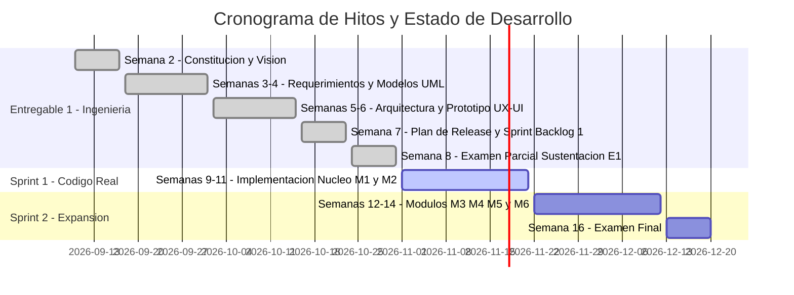

# Sistema de Gestión de la Clínica San Rafael — SIGES SR

[-blue.svg)](#-estado-actual-del-proyecto)
[](https://fiis.uni.edu.pe/)
[](#-arquitectura-y-stack-tecnol%C3%B3gico)
[](#)

Repositorio oficial del **Proyecto Integrador (Parte 1)** para el curso **Taller de Ingeniería de Software I (SW705)** — Facultad de Ingeniería Industrial y de Sistemas (FIIS), Universidad Nacional de Ingeniería (UNI).

---

## 👥 Equipo de Desarrollo (Equipo E)

| Integrante | Rol en el Proyecto | Responsabilidad Principal |
| :--- | :---: | :--- |
| **Jhostin Leonardo Rodríguez Neyra** | **Scrum Master** | Gestión ágil, facilitación de sprints, seguridad y auditoría (HU17). |
| **Rafael Olivos Gallardo** | **Product Owner** | Gestión del backlog, visión del producto, HCE unificada (HU03) y perfil de paciente. |
| **Carlos Benjamin Fernández Iquise** | **Developer** | Arquitectura técnica, base de datos, disponibilidad de agenda (HU01, HU05) y prototipos. |

* **Patrocinador:** Gerencia General, Clínica San Rafael S.A.C.
* **Product Owner de Referencia:** Docente del curso SW705.

---

## 📌 Descripción del Proyecto

**SIGES SR** es una plataforma clínico-administrativa orientada a resolver la fragmentación operativa y clínica de la **Clínica San Rafael S.A.C.** (San Borja, Lima). 

Actualmente, la clínica gestiona historias clínicas en papel y hojas de cálculo dispersas, con un ausentismo en citas del **18 %** por saturación telefónica, demoras de hasta 48 horas en entrega de resultados de laboratorio y reconciliaciones manuales de facturación con 5 EPS/aseguradoras. 

### Visión de la Solución
Integrar en un único sistema web la **Historia Clínica Electrónica (HCE)** unificada y una **Agenda Médica Multiespecialidad** con validación consolidada de disponibilidad, garantizando estricta trazabilidad médico-legal y cumplimiento de la **Ley N.° 29733 (Ley de Protección de Datos Personales)** mediante control de acceso por roles (RBAC) y borrado lógico inmutable.

---

## 📊 Estado Actual del Proyecto



### 📍 Fase actual: **Sprint 1 en implementación (Semanas 9 a 11)**

**Estado revisado al 08/11/2026**, a partir del código y las evidencias disponibles. Según el cronograma, el equipo se encuentra en la semana 10. La documentación del Entregable 1 está disponible; su aprobación académica no está registrada.

El incremento actual permite a admisión iniciar sesión, buscar un paciente existente, consultar disponibilidad y confirmar una cita presencial desde la web. El Sprint 1 sigue abierto.

| Área | Implementado | Pendiente principal |
| :--- | :--- | :--- |
| Seguridad y auditoría (HU17) | Login JWT, control por roles, verificación de cuentas activas y auditoría. | Extender la cobertura a los módulos restantes y validar la DoD. |
| Pacientes y base de HCE (M1; HU06/HU07 parciales) | Registro, búsqueda, ficha demográfica, antecedentes y alergias por API. | Registro desde la web, interfaz clínica, CIE-10, recetas, signos vitales e HCE cronológica. |
| Agenda y citas (M2; HU01 parcial) | Horarios, catálogo, disponibilidad y reserva transaccional por API; reserva desde la web de admisión. | Reprogramación, cancelación, administración de horarios, feriados y excepciones. |
| Laboratorio, facturación, reportes y portal (M3–M6) | Planificados para Sprint 2; sin módulos funcionales implementados. | Implementación y validación. |
| Infraestructura y entrega | Docker Compose para PostgreSQL y Redis; API y web locales. | Contenedores de aplicaciones, CI/CD y respaldo/restauración. |

> **Alcance acordado de HU04/HU06/HU10:** admisión registra solo datos demográficos y de contacto; enfermería consulta pacientes con llegada registrada y captura signos vitales y observaciones, sin acceso al historial médico; el médico consulta la evaluación previa y la HCE. Las [historias actualizadas](entregables/semana-6/historias-usuario-update.md) incluyen los criterios. La API ya rechaza antecedentes y alergias en el alta de admisión y restringe el perfil clínico al médico; HU04 y HU10 siguen pendientes.

No se declara ninguna historia terminada hasta completar criterios de aceptación, revisión por PR y validación en contenedores conforme a la DoD. Los modelos de datos por sí solos no constituyen módulos funcionales completos.

* **✅ Documentación de Ingeniería Consolidada (aprobación académica pendiente de registrar):**
  * Requerimientos funcionales (RF01–RF13) y no funcionales (RNF01–RNF06) especificados con criterios de aceptación en Gherkin (`Dado/Cuando/Entonces`).
  * Arquitectura de software modelada bajo el estándar C4 (Contexto, Contenedores y Componentes).
  * Modelo de Base de Datos relacional normalizado con soporte DDL de borrado lógico (`ck_consulta_anulacion`), diagramas ER y scripts SQL.
  * Wireframes de agendamiento, alertas y HCE unificada.
* **Implementado en backend:** conexión Prisma, prefijo `/api`, validación de DTO, CORS configurable, login JWT, permisos por rol y auditoría explícita en servicios y guard. Registro de pacientes sin cuenta de portal, solo con datos demográficos y de contacto, búsqueda por DNI exacto y consulta de ficha. Los hashes nunca se devuelven en la API.
* **Integridad en PostgreSQL:** migraciones con anulación justificada, bloqueo de borrado físico de consultas, antecedentes y alergias, bitácora append-only y exclusión de horarios solapados por médico. Las restricciones SQL complementan el esquema Prisma.
* **Interfaz de admisión implementada:** acceso con cuenta de admisión, búsqueda y selección de pacientes, catálogo de especialidades/médicos, consulta de disponibilidad, confirmación de reserva, listado del día y registro de llegada. Maneja turnos ocupados (409) y pérdida de sesión (401). Ver [guía de la interfaz](apps/web/ADMISSION.md).
* **Pendiente:** interfaz clínica, registro de pacientes desde la web, reprogramación/cancelación de citas, CIE-10/recetas/signos vitales/HCE cronológica, notificaciones, respaldo/restauración y CI/CD. HU01 cuenta con horarios, disponibilidad y reserva por API y web. HU06, HU07 y HU17 tienen avance de backend; ninguna historia se considera terminada hasta cumplir toda la DoD, revisión por PR y validación en contenedores.

---

## 🧩 Módulos del Sistema y Plan de Release

| Módulo | Alcance | Prioridad | Sprint Asignado |
| :--- | :--- | :---: | :---: |
| **M1. Historia Clínica Electrónica (HCE)** | Paciente único, antecedentes, consultas CIE-10, recetas, signos vitales y visualización unificada. | Must | **Sprint 1** *(En desarrollo)* |
| **M2. Agenda y Citas Médicas** | Disponibilidad consolidada de médicos, agendamiento, reprogramación, cancelación y recordatorios. | Must | **Sprint 1** *(En desarrollo)* |
| **M3. Laboratorio e Imágenes** | Generación de órdenes médicas y registro/consulta de resultados digitales. | Should | **Sprint 2** |
| **M4. Facturación y Convenios** | Emisión de comprobantes, categorización por convenio (particular, EPS, SOAT) y copagos. | Should | **Sprint 2** |
| **M5. Reportes Gerenciales** | Ocupación de consultorios, tiempos de espera e indicadores de inasistencia. | Could | **Sprint 2** |
| **M6. Portal del Paciente** | Agendamiento autónomo en línea y vista de citas. | Could | **Sprint 2** |

---

## 🏛 Arquitectura y Stack Tecnológico

El sistema adopta una **Arquitectura en Capas con API REST Monolítica Modular**, priorizando transacciones **ACID** para evitar colisiones en citas médicas, asegurar la trazabilidad médico-legal y optimizar costos de infraestructura (ajustado a una sola sede y 8,000 pacientes).

```
                      +-----------------------------+
                      |      React + Vite SPA       |
                      |   (Personal Clínico/Portal) |
                      +--------------+--------------+
                                     |  HTTPS / REST
                                     v
                      +-----------------------------+
                      |        Nginx Reverse        |
                      +--------------+--------------+
                                     |
                                     v
                      +-----------------------------+
                      |      NestJS Backend API     |
                      |  [RBAC Guard | Auditoría]   |
                      |  +-----------------------+  |
                      |  | M1 | M2 | M3 | M4 | M5|  |
                      |  +-----------------------+  |
                      +-------+-------------+-------+
                              |             |
                              v             v
                    +------------+    +------------+
                    | PostgreSQL |    |   Redis    |
                    | (Prisma)   |    |  (BullMQ)  |
                    +------------+    +------------+
```

### Tecnologías Principales:
* **Backend implementado:** Node.js, TypeScript, [NestJS](https://nestjs.com/), Prisma ORM, JWT, bcryptjs, class-validator y OpenAPI con Swagger UI.
* **Frontend:** React, Vite y Tailwind CSS, con interfaz de acceso y agenda para admisión.
* **Base de Datos & Cache:** PostgreSQL 16, Redis.
* **Pruebas:** Vitest y Supertest, incluyendo pruebas de migraciones en un esquema PostgreSQL temporal.
* **Infraestructura:** Docker Compose para PostgreSQL y Redis. La API y la web se ejecutan localmente.
* **Arquitectura objetivo (pendiente):** BullMQ, Nginx, Lucide y GitHub Actions. El diagrama anterior representa el diseño objetivo.

---

## 📁 Estructura del Repositorio

```text
├── apps/
│   ├── api/             # NestJS, Prisma, autenticación, auditoría y pacientes
│   └── web/             # React + Vite + Tailwind, acceso y agenda de admisión
├── entregables/
│   ├── semana-2/       # Acta de constitución y documento de visión
│   ├── semana-3/       # Guía de requerimientos iniciales
│   ├── semana-4/       # Especificación ERS, PC1 y diagramas UML
│   ├── semana-5/       # Estilo arquitectónico y vistas física/lógica
│   ├── semana-6/       # Wireframes UX/UI (W01, W02, W03) y modelo relacional
│   ├── semana-7/       # Modelos C4, workspace Structurizr DSL y consolidado
│   └── semana-8/       # [DOCUMENTO PRINCIPAL] sprint-1.md (Entregable 1 completo)
├── README.md           # Ficha técnica y estado del proyecto
├── docker-compose.yml  # PostgreSQL 16 y Redis 7
└── .env.example        # Variables de infraestructura
```

> 📄 **Documentación completa de ingeniería:** Puedes consultar la memoria técnica integral en [entregables/semana-8/sprint-1.md](entregables/semana-8/sprint-1.md).

---

## Ejecución local

Requisitos: Node.js 24 LTS, npm y Docker Compose. En PowerShell usar `npm.cmd` si la política de scripts impide ejecutar `npm.ps1`. También se puede usar PostgreSQL 16 ya instalado.

Desde la raíz:

```powershell
Copy-Item .env.example .env
docker compose up -d
Copy-Item apps/api/.env.example apps/api/.env
```

Ajustar `DATABASE_URL` en `apps/api/.env` al usuario, contraseña y puerto de PostgreSQL. Generar un secreto con `node -e "console.log(require('crypto').randomBytes(48).toString('hex'))"` y asignarlo a `JWT_SECRET` (mínimo 32 caracteres). No versionar archivos `.env`. Si ya existen, conservarlos y agregar solo las variables faltantes.

Backend:

```powershell
cd apps/api
npm.cmd ci
npm.cmd run prisma:generate
npm.cmd run db:migrate
npm.cmd run start:dev
```

API: `http://localhost:3000/api`. `GET /api` conserva el saludo de ejemplo; no es una comprobación de salud de PostgreSQL. Para ejecutar el compilado: `npm.cmd run build` y `npm.cmd run start:prod`.

Frontend, en otra terminal:

```powershell
cd apps/web
npm.cmd ci
npm.cmd run dev
```

Abrir `http://localhost:5173`. `CORS_ORIGIN` debe coincidir con el origen de la web.

La web usa `VITE_API_URL` (por defecto `http://localhost:3000/api`); copiar `apps/web/.env.example` a `apps/web/.env.local` para cambiarla. Ingresar con una cuenta de admisión existente. El token permanece en memoria y se descarta al cerrar sesión o recargar. Consultar [la guía de admisión](apps/web/ADMISSION.md) para el flujo y sus límites.

### Documentación OpenAPI / Swagger

Con la API iniciada:

- **Swagger UI:** [http://localhost:3000/api/docs](http://localhost:3000/api/docs).
- **Contrato JSON:** [http://localhost:3000/api/openapi.json](http://localhost:3000/api/openapi.json).
- **Contrato YAML:** [http://localhost:3000/api/openapi.yaml](http://localhost:3000/api/openapi.yaml).

Los 15 endpoints actuales están documentados por módulo, con cuerpos, parámetros, restricciones, respuestas y errores. Las rutas protegidas declaran Bearer JWT y roles permitidos (`x-roles`), derivados del mismo decorador que usa el guard. La documentación es pública y no consulta PostgreSQL para generarse; las operaciones de negocio conservan sus permisos y requieren la base de datos. No se incluyen contraseñas reales, tokens ni hashes.

Para probar desde Swagger, ejecutar `POST /api/auth/login` con una cuenta local, copiar `accessToken` y pegarlo en **Authorize** (solo el token). El token no se conserva al recargar. **Try it out** ejecuta operaciones reales contra la API: usar datos ficticios del entorno de desarrollo.

La especificación se genera desde controladores y DTO al iniciar la aplicación. Al añadir endpoints, documentar su operación con `ApiContract`, declarar `Roles` o `Public`, anotar las propiedades de entrada y definir su esquema de respuesta. `apps/api/test/openapi.e2e-spec.ts` verifica cobertura, seguridad, esquemas, referencias y publicación de UI/JSON/YAML. Ejecutar desde `apps/api`: `npm.cmd run test:e2e -- openapi`.

### Cuentas ficticias de demostración

Desde `apps/api`, definir `DEMO_PASSWORD` en el entorno local (no versionado), con al menos 12 caracteres y hasta 72 bytes UTF-8, y ejecutar `npm.cmd run db:seed:demo` después de aplicar las migraciones. Crea `demo.admision`, `demo.medico`, `demo.medico.pediatria` y `demo.enfermeria` con hash bcrypt. Las cuentas nuevas usan esa contraseña; las existentes conservan su contraseña y sus datos.

La carga incluye dos especialidades, dos médicos asociados a sus cuentas, dos consultorios y cinco bloques semanales ficticios:

| Cuenta médica | Especialidad | Consultorio | Días | Horario local (`America/Lima`) | Duración |
| :--- | :--- | :--- | :--- | :--- | :--- |
| `demo.medico` | Medicina General (DEMO) | Consultorio DEMO 1 | Lunes, miércoles y viernes | 08:00–12:00 | 20 minutos |
| `demo.medico.pediatria` | Pediatria (DEMO) | Consultorio DEMO 2 | Martes y jueves | 09:00–12:00 | 30 minutos |

Los códigos `DEMO0001` y `DEMO0002` son identificadores ficticios, no matrículas profesionales reales. Los horarios usan una fecha de referencia UTC para almacenar las horas locales sin desplazarlas. Se puede repetir el comando sin duplicar estos registros. Toda la carga es transaccional: si una cuenta tiene un rol incompatible o está inactiva, un consultorio está inactivo, un médico/horario existente difiere de la configuración esperada o PostgreSQL rechaza un cruce, se cancela la carga completa sin sobrescribir los datos existentes. Revisar el conflicto antes de volver a ejecutarla.

El seed rechaza `NODE_ENV=production`; verificar además que `DATABASE_URL` apunte al entorno de desarrollo antes de ejecutarlo. No crea pacientes ni citas: registrar pacientes mediante la API permite comprobar validaciones, permisos y auditoría. Estos datos alimentan el catálogo y la disponibilidad y permiten probar la reserva con pacientes registrados previamente por API. Las pruebas del seed se ejecutan con `npm.cmd run test:db` en un esquema temporal independiente.

### Contrato HTTP implementado

| Método y ruta | Permiso | Comportamiento |
| :--- | :--- | :--- |
| `POST /api/auth/login` | Público | `{ "username": "...", "password": "..." }`; devuelve `accessToken` (1 hora). |
| `GET /api/auth/me` | Cualquier rol autenticado | Devuelve exclusivamente el ID y rol actual de la cuenta activa. |
| `GET /api/agenda/catalog` | admision, medico, enfermeria | Especialidades con médicos activos de rol médico y al menos un horario en consultorio activo; nombres e IDs para los selectores de agenda. Registra `READ_AGENDA_CATALOG`. |
| `GET /api/agenda/availability?fecha=YYYY-MM-DD&especialidadId=1&medicoId=1` | admision, medico, enfermeria | Turnos futuros disponibles; `medicoId` es opcional. |
| `POST /api/agenda/appointments` | admision | Reserva transaccional con auditoría; conflicto de ocupación devuelve 409. |
| `POST /api/agenda/appointments/:id/arrival` | admision | Registra llegada de una cita presencial del día en Lima; no cambia su estado. |
| `GET /api/agenda/nursing-queue?pagina=1&limite=50` | enfermeria | Pacientes de hoy con llegada registrada y preparación pendiente, sin información clínica. |
| `POST /api/patients` | admision | Registra únicamente datos demográficos y de contacto; rechaza antecedentes y alergias con 400; documento duplicado devuelve 409 y `patientId`. |
| `GET /api/patients?q=87654321` | admision, medico, enfermeria | Busca únicamente por DNI exacto de 8 dígitos; cero o un resultado; sin campos clínicos. |
| `GET /api/patients/:id` | admision, medico, enfermeria | Ficha demográfica. |
| `GET /api/patients/:id/clinical-profile` | medico | Ficha con antecedentes y alergias; todavía no es la HCE cronológica de HU03. |

Enviar `Authorization: Bearer <accessToken>` en rutas protegidas. Los usuarios inactivos pierden acceso aunque el token no haya expirado. Las rutas nuevas requieren declarar sus roles explícitamente. Las operaciones de pacientes registran auditoría; futuras rutas clínicas deberán integrar el mismo servicio. Si no se puede escribir auditoría, no se devuelve información del paciente.

Ejemplo de registro (solo datos ficticios):

```json
{
  "tipoDocumento": "DNI",
  "numeroDocumento": "87654321",
  "nombres": "Paciente Ficticio",
  "apellidos": "Prueba",
  "fechaNacimiento": "1990-01-01",
  "sexo": "F",
  "telefono": "999888777",
  "correo": "ficticio@example.test"
}
```

### Verificación

Las pruebas manuales de API se realizan con **Bruno**. Consultar el [registro de pruebas y evidencias](entregables/semana-8/pruebas/registro-pruebas.md), que conserva resultados manuales del 30/10/2026 y el reporte de horarios del 28/10/2026. Sus pendientes describen aquella versión: disponibilidad, reserva e interfaz ya existen en el código actual. Las evidencias históricas no certifican el flujo integrado actual.

Desde `apps/api`: `npm.cmd run build`, `npm.cmd run lint`, `npm.cmd test`, `npm.cmd run test:e2e` y `npm.cmd run test:db`. Las pruebas HTTP e2e usan persistencia simulada; `test:db` aplica todas las migraciones y prueba el flujo HTTP contra un esquema temporal único, que elimina al terminar. Requiere PostgreSQL y permisos para crear esquemas y la extensión `btree_gist`. No reinicia las tablas del esquema de la aplicación.

Desde `apps/web`: `npm.cmd run build`, `npm.cmd run lint` y `npm.cmd run test:e2e`. Las pruebas de navegador usan Microsoft Edge con API simulada y verifican acceso, reserva, colisiones, sesión, filtros y adaptación móvil; no sustituyen una ejecución integrada con PostgreSQL.

Las migraciones no corrigen datos históricos incompatibles: si ya existen citas solapadas o anulaciones incompletas, se debe revisar esos datos antes de desplegarlas. En despliegue usar un rol de aplicación sin permisos de superusuario ni DDL; los triggers no protegen frente al administrador de la base de datos.

### Comprobaciones de esta revisión (08/11/2026)

| Comprobación | Resultado |
| :--- | :--- |
| API: `npm.cmd test` | 1 prueba aprobada. |
| API: `npm.cmd run test:e2e` | 41 pruebas aprobadas en 4 archivos; persistencia simulada. |
| Web: `npm.cmd run build` | Compilación correcta. |
| Web: `npm.cmd run lint` | Sin errores. |

En esta revisión no se ejecutaron `test:db` ni Playwright, ni se verificó el flujo integrado con PostgreSQL. Los resultados anteriores no acreditan la aceptación completa de las historias.

### Alcance implementado de HU01 y siguientes pasos

Primera parte implementada: modelos `Consultorio` y `HorarioMedico`, con horarios semanales por médico y consultorio. Días ISO (1=lunes, 7=domingo), horas locales de `America/Lima` y duración configurable de 20 minutos por defecto. PostgreSQL rechaza cruces del mismo médico o consultorio, días inválidos, intervalos invertidos y duraciones que no caben. Los bloques adyacentes están permitidos. Horas en minutos completos, dentro del mismo día (00:00 a 23:59); sin vigencias, feriados ni excepciones por fecha todavía. Prisma representa las horas `TIME` mediante `Date` con fecha de referencia `1970-01-01` y componente horario UTC: no convertirlas usando la zona horaria del servidor.

El modelo permite bloques de varias citas; la consulta de disponibilidad genera únicamente turnos completos desde `horaInicio`, dejando fuera cualquier resto menor que `duracionCitaMin`. Los horarios aún no tienen endpoints de administración; el seed de demostración permite cargar bloques ficticios. La reserva por API valida que cada cita nueva coincida con un turno completo del horario; no modifica las citas anteriores.

Consulta implementada: `GET /api/agenda/availability?fecha=2026-11-09&especialidadId=1&medicoId=1`. Requiere Bearer JWT con rol `admision`, `medico` o `enfermeria`. `fecha` (YYYY-MM-DD válido) y `especialidadId` (entero positivo) son obligatorios; `medicoId` es opcional. Los IDs del ejemplo deben corresponder a los datos locales. Campos desconocidos o parámetros inválidos devuelven 400.

Devuelve `{ fecha, zonaHoraria: "America/Lima", especialidadId, turnos }`. Cada turno contiene `medicoId`, `medico: { nombres, apellidos }`, `consultorioId`, `consultorio`, `inicio` y `fin`. Los instantes se serializan en UTC (08:00 de Lima corresponde a 13:00Z). Solo incluye turnos completos futuros, de médicos activos con rol médico y consultorios activos. Excluye solapamientos con citas no canceladas, incluso si comienzan el día anterior. Los intervalos adyacentes se permiten. Sin coincidencias o con fecha pasada devuelve `turnos: []`. La lectura registra `READ_AVAILABILITY` y no expone pacientes ni detalles de citas.

La disponibilidad es informativa: no bloquea turnos y puede cambiar mientras otro usuario reserva. No contempla feriados ni excepciones por fecha. Las pruebas HTTP con persistencia simulada están en `apps/api/test/availability.e2e-spec.ts` y se ejecutan con `npm.cmd run test:e2e`; no constituyen evidencia de ejecución contra PostgreSQL real.

Reserva implementada: `POST /api/agenda/appointments`, exclusivamente para `admision` con Bearer JWT. Ejemplo (reemplazar IDs y fecha por datos locales y un turno futuro):

```json
{
  "pacienteId": 1,
  "medicoId": 1,
  "inicio": "2026-11-09T08:00:00-05:00",
  "motivo": "Control",
  "canalOrigen": "presencial"
}
```

`pacienteId`, `medicoId` e `inicio` son obligatorios. El inicio requiere zona explícita (`Z` o desplazamiento), segundos cero y debe coincidir con un turno completo futuro del horario de Lima. Se acepta el instante UTC equivalente que devuelve disponibilidad. `motivo` es opcional (hasta 300 caracteres); `canalOrigen` admite `presencial` (por defecto) o `telefono`. La duración se calcula en servidor desde el horario; el cliente no puede elegir fin, estado, creador ni modalidad. Esta ruta crea citas presenciales en estado `programada`.

Respuestas: 201 con ID, paciente/médico, inicio/fin UTC, estado, canal y modalidad; 400 para datos inválidos, turnos pasados o fuera de horario; 404 para paciente inexistente o médico inexistente/inactivo; 409 si una cita no cancelada ocupa total o parcialmente el intervalo. La transacción bloquea la fila del médico para serializar reservas entre procesos, vuelve a comprobar el solapamiento y guarda cita y auditoría `CREATE_CITA` juntas: si falla la auditoría, se revierte la reserva. La restricción de exclusión existente en PostgreSQL sigue protegiendo contra solapamientos. No se impide que un paciente tenga citas con médicos distintos a la misma hora.

Las pruebas de `apps/api/test/integrity.db-spec.ts` verifican dos reservas HTTP simultáneas (201/409), cancelación y nueva reserva, actualización de disponibilidad, validaciones y reversión por fallo de auditoría contra un esquema PostgreSQL temporal. Ejecutar `npm.cmd run test:db` con la base de desarrollo configurada.

Interfaz de admisión implementada: consultar disponibilidad, elegir un paciente existente y confirmar la reserva desde la web. Siguiente incremento: listado y gestión de citas (reprogramación/cancelación) y registro de pacientes desde la interfaz. Feriados y excepciones siguen pendientes. La aceptación de HU01 continúa sujeta a la DoD y revisión por PR.

---

## 🛠 Convención de Trabajo y Commits

El equipo sigue el estándar **[Conventional Commits](https://www.conventionalcommits.org/)** en idioma inglés:

* `docs(week-N): <descripcion>`: Cambios en documentación o especificaciones de ingeniería.
* `feat(<modulo>): <descripcion>`: Nueva funcionalidad de código.
* `fix(<modulo>): <descripcion>`: Corrección de errores.
* `test(<modulo>): <descripcion>`: Adición o refactorización de pruebas.

---

## ⚖️ Marco Legal y Normativo
* **Requisito del proyecto asociado a la Ley N.° 29733:** auditar lecturas y modificaciones clínicas, restringir el acceso por rol y conservar entradas mediante anulación sustentada. La implementación actual cubre autenticación y pacientes; el resto de la HCE y la revisión integral de cumplimiento siguen pendientes.

### Registro de llegada de pacientes

`POST /api/agenda/appointments/:id/arrival`, con token de admisión y sin campos en el cuerpo, registra la hora del servidor en `llegadaEn`. Solo admite citas presenciales del día actual en `America/Lima`, en estado `programada`, `confirmada` o `reprogramada`. Se permite registrar la llegada antes o después de la hora programada, dentro del mismo día.

Devuelve 200 con `{ id, estado, llegadaEn }`; 400 para ID/cuerpo inválido o cita de otro día, 404 para cita inexistente y 409 para modalidad o estado incompatible. Una repetición válida conserva la primera hora y no duplica auditoría. La actualización y `REGISTER_ARRIVAL` se guardan en una transacción con bloqueo de la cita; si falla la auditoría se revierte la llegada. La cita no pasa a `atendida`. El campo ya existe en las migraciones, sin cambios de esquema.

Este incremento implementa la API de llegada; la interfaz de admisión, la interfaz de pendientes de enfermería (HU04) y el registro de signos vitales (HU10) siguen pendientes.

### Lista de evaluación previa de enfermería (HU04)

`GET /api/agenda/nursing-queue` requiere un token de `enfermeria`. La fecha se determina en el servidor en `America/Lima`; no admite consultar otros días. Solo incluye citas presenciales de hoy, con llegada registrada, sin preparación completada y en estado `programada`, `confirmada` o `reprogramada`. Se ordenan por llegada e ID. Las consultas quedan auditadas como `READ_NURSING_QUEUE`; si falla la auditoría no se leen ni devuelven pacientes.

Parámetros opcionales: `pagina` (1–10000, por defecto 1) y `limite` (1–100, por defecto 50); los campos desconocidos o inválidos devuelven 400. Devuelve `{ fecha, zonaHoraria, pagina, limite, hayMas, pacientes }`. Cada entrada contiene `citaId`, identificación y edad del paciente, `inicio`, `llegadaEn`, médico, especialidad y `estadoPreparacion: "pendiente"`. No incluye antecedentes, alergias, indicaciones, diagnósticos, resultados, observaciones clínicas ni datos de contacto. Otros roles reciben 403.

**Migración necesaria:** desde `apps/api`, ejecutar `npm.cmd run db:migrate` y `npm.cmd run prisma:generate`. La migración `20261108000100_nursing_preparation` agrega `preparacionCompletadaEn`, separado de llegada y estado de la cita. Una preparación completada requiere una llegada y no puede ser anterior a ella. Los datos existentes quedan con preparación pendiente; no se infiere una evaluación completada a partir de otros registros. HU10 registra los signos vitales y completa este campo en la misma transacción.

Este incremento entrega la API de HU04. La interfaz de enfermería y su selección visual de paciente siguen pendientes; no se declara la historia terminada.

### Registro de signos vitales (HU10)

`POST /api/agenda/appointments/:id/vital-signs` requiere rol `enfermeria`. Precondiciones: cita presencial de hoy en Lima, estado `programada`, `confirmada` o `reprogramada`, asistencia registrada y preparación pendiente. La llegada registrada y la preparación pendiente representan al paciente esperando en sala; no existe una comprobación física adicional desde la API.

Ejemplo con datos ficticios:

```json
{
  "temperaturaC": 36.5,
  "presionSistolica": 120,
  "presionDiastolica": 80,
  "frecuenciaCardiaca": 75,
  "frecuenciaRespiratoria": 18,
  "saturacionOxigeno": 98,
  "pesoKg": 65.5,
  "tallaCm": 170,
  "observaciones": "Observación de enfermería ficticia"
}
```

Temperatura (°C), presión sistólica/diastólica (mmHg), frecuencia cardíaca (latidos/min), frecuencia respiratoria (respiraciones/min) y saturación (%) son obligatorias. Peso, talla y observaciones (máximo 1000 caracteres) son opcionales. Se requieren números JSON; se rechazan campos desconocidos, datos de autoría, fecha, paciente, diagnósticos o prescripciones. Los límites implementados son validaciones técnicas de entrada, no una clasificación clínica de normalidad ni un diagnóstico: temperatura 0.1–100 (1 decimal), presiones y frecuencias 1–1000 (enteros), saturación 0–100 (1 decimal), peso 0.01–2000 (2 decimales) y talla 0.1–400 (1 decimal).

Devuelve 201 con la evaluación guardada. El paciente se vincula mediante su cita; autor y fecha los determina el servidor. Una transacción bloquea la cita, crea la evaluación, completa `preparacionCompletadaEn` y registra `CREATE_VITAL_SIGNS`. Si falla cualquier paso, se revierte todo. No cambia el estado de la cita a `atendida`. Otra evaluación para esa cita devuelve 409 y no sobrescribe los datos. Otros conflictos de precondición devuelven 409; cita de otro día o datos inválidos, 400; cita inexistente, 404.

`GET /api/agenda/appointments/:id/vital-signs` permite únicamente al médico asignado consultar las mediciones, observaciones y autoría de esa cita, con auditoría `READ_VITAL_SIGNS`. Devuelve 404 si no hay evaluación accesible. Enfermería y admisión reciben 403; este endpoint no les da acceso al historial médico.

Aplicar `npm.cmd run db:migrate` y `npm.cmd run prisma:generate` desde `apps/api`. La migración `20261108000200_nursing_vital_signs` crea `evaluacion_previa`, con una entrada por cita y conservación de los datos originales mediante bloqueo de actualización y borrado. Correcciones versionadas quedan fuera de este incremento. La interfaz de captura y la vista médica siguen pendientes.

### Citas del día y llegada desde la web de admisión

Después de iniciar sesión, elegir **Citas del día**. La pantalla muestra las citas de la fecha actual de Lima, permite filtrar por estado y recorrer páginas de 20 registros. Incluye paciente/documento, médico, especialidad, horario, modalidad, estado y llegada. **Registrar llegada** abre una confirmación de identidad y presencia; al confirmar, se actualiza la lista. Citas canceladas, atendidas, con inasistencia, virtuales o con llegada registrada no ofrecen esta acción. Un fallo de conexión no reintenta la operación automáticamente; actualizar la lista permite comprobar el resultado. Durante el envío se bloquean navegación y cierre de sesión. La reserva sigue disponible en **Reservar cita**.

API: `GET /api/agenda/appointments`, exclusiva de `admision`, auditada como `READ_DAILY_APPOINTMENTS`. Usa el día actual del servidor en `America/Lima`; admite `pagina` (1–10000, predeterminado 1), `limite` (1–100, predeterminado 50), `medicoId` y `estado`. Los parámetros desconocidos se rechazan con 400. Devuelve `{ fecha, zonaHoraria, pagina, limite, hayMas, citas }`, ordenadas por inicio e ID, con todos los estados y modalidades. No expone motivo de consulta, historial, signos vitales ni datos de contacto. Contrato completo en Swagger. No requiere migraciones adicionales.

Las pruebas HTTP verifican roles, validaciones, selección de campos, fecha de Lima, filtros, paginación y fallo de auditoría. Playwright verifica confirmación de llegada, actualización, restricciones visuales, filtros, paginación, sesión, errores de conexión y ancho móvil con API simulada; la ejecución integrada con PostgreSQL sigue pendiente.

### Búsqueda exclusiva por DNI

`GET /api/patients?q=87654321` acepta solo DNI de 8 dígitos (mantiene ceros iniciales), con coincidencia exacta y tipo de documento `DNI`. Devuelve un arreglo vacío o un paciente. Nombres, apellidos, DNI parciales y filtros como `limit` se rechazan con 400. La web habilita **Buscar** solo al completar los 8 dígitos. El paciente debe haberse registrado previamente en la misma base de datos usada por la API; no se crea automáticamente al buscarlo.

### Interfaz de enfermería

La web admite acceso de admisión y enfermería, comprobando el rol actual en `/auth/me`. Con `demo.enfermeria` se abre **Evaluación previa**: pacientes presentes y pendientes, selección de cita, identificación, formulario de signos vitales y observaciones y confirmación de preparación completada. La API vuelve a verificar todas las precondiciones al guardar. No se muestran controles de admisión ni se consulta el historial médico. La pantalla del médico sigue pendiente.

Consultar la [guía de acceso y evaluación previa](apps/web/ADMISSION.md) para campos, errores y límites. Las pruebas de navegador incluyen registro, validación, conflictos, paginación, permisos, sesión, doble envío, fallos de conexión y adaptación móvil. La verificación con PostgreSQL real sigue pendiente.
