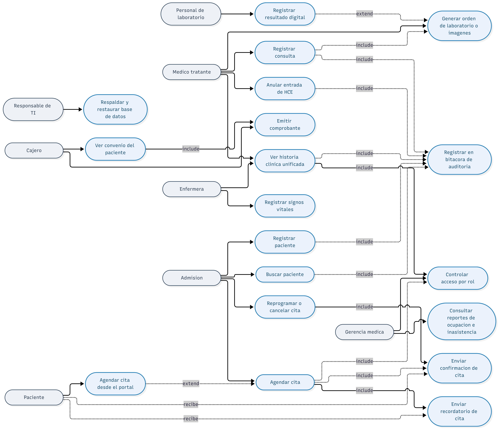
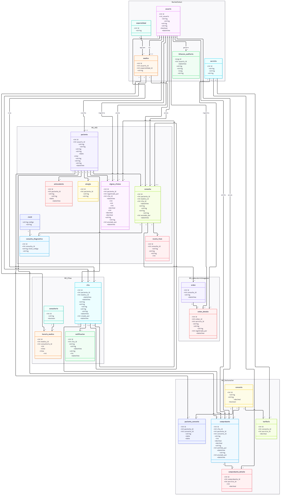
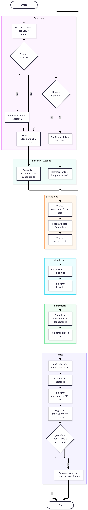
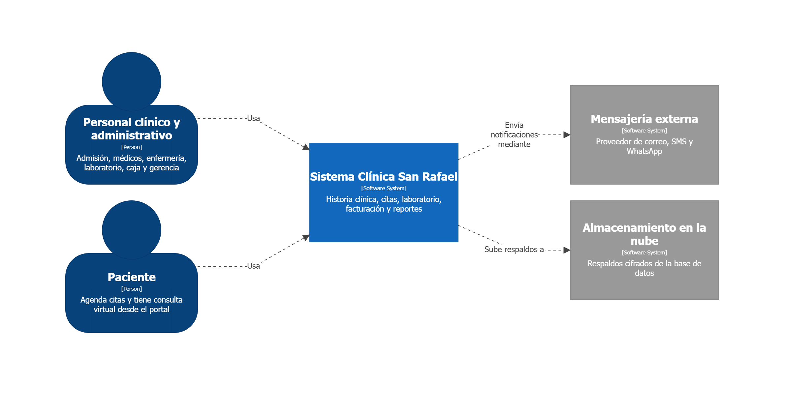
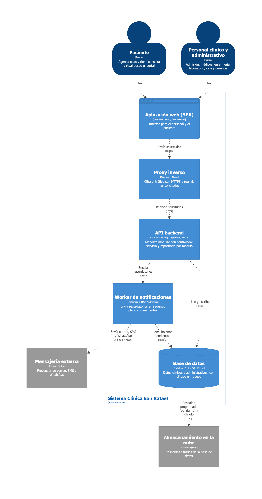
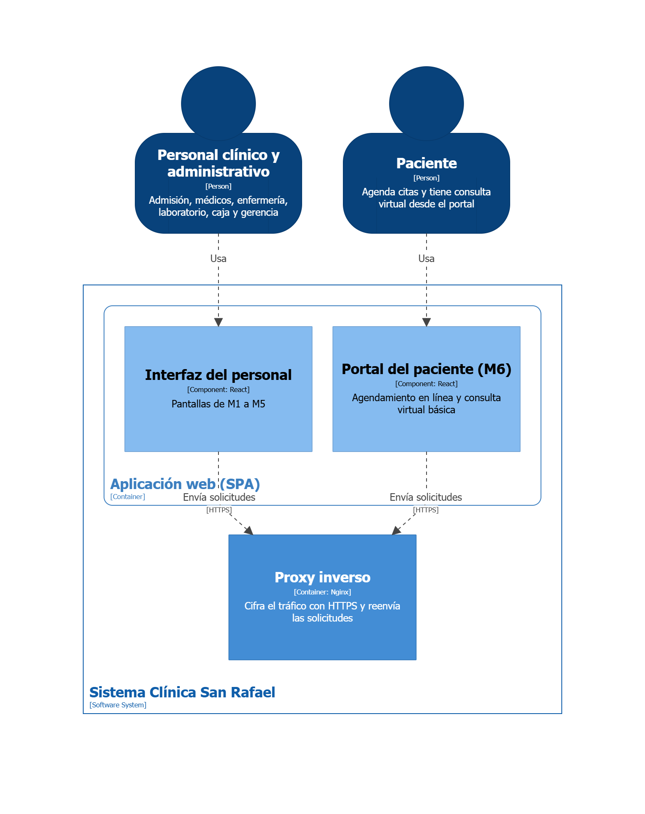
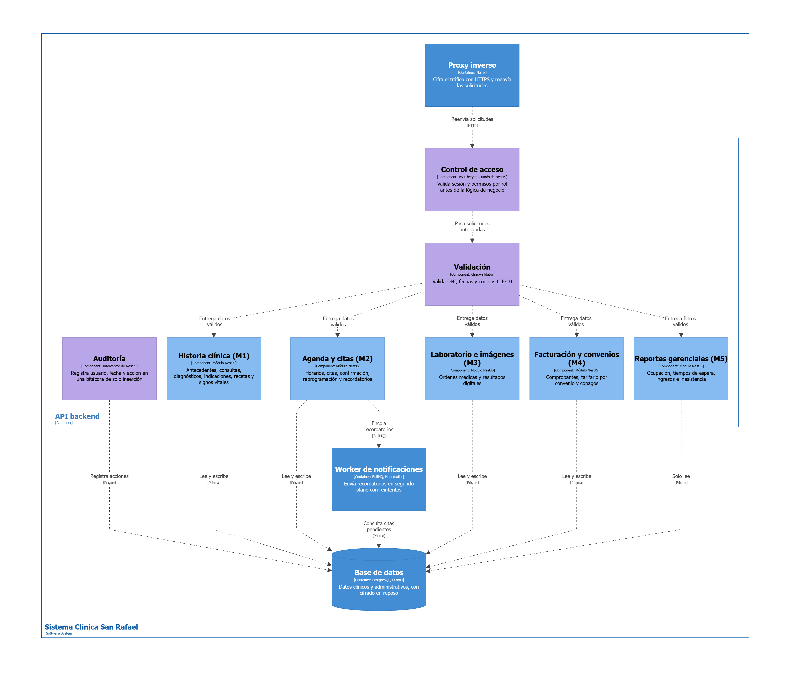
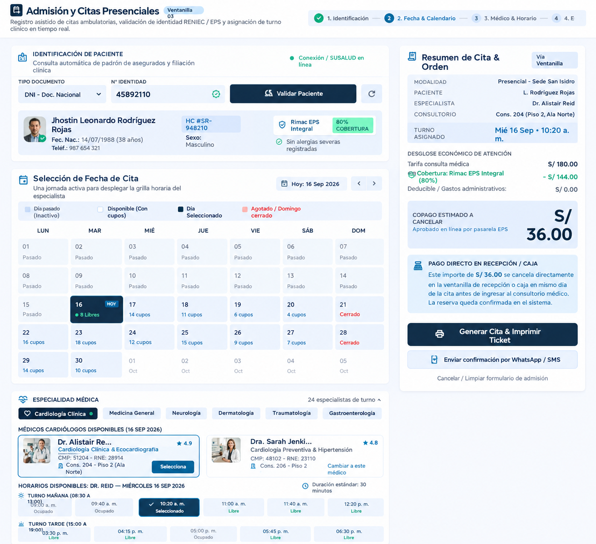
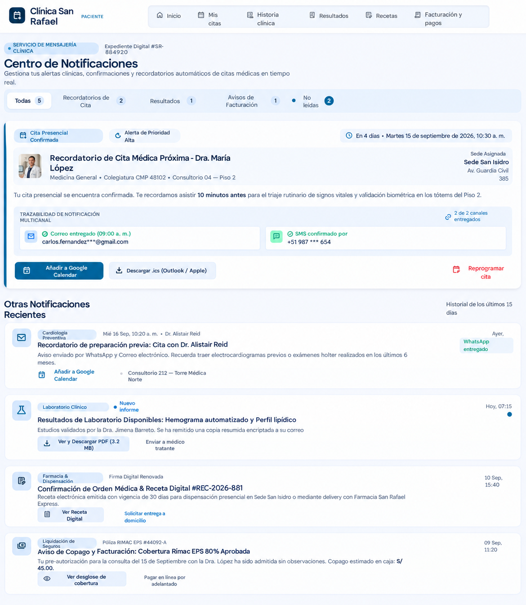
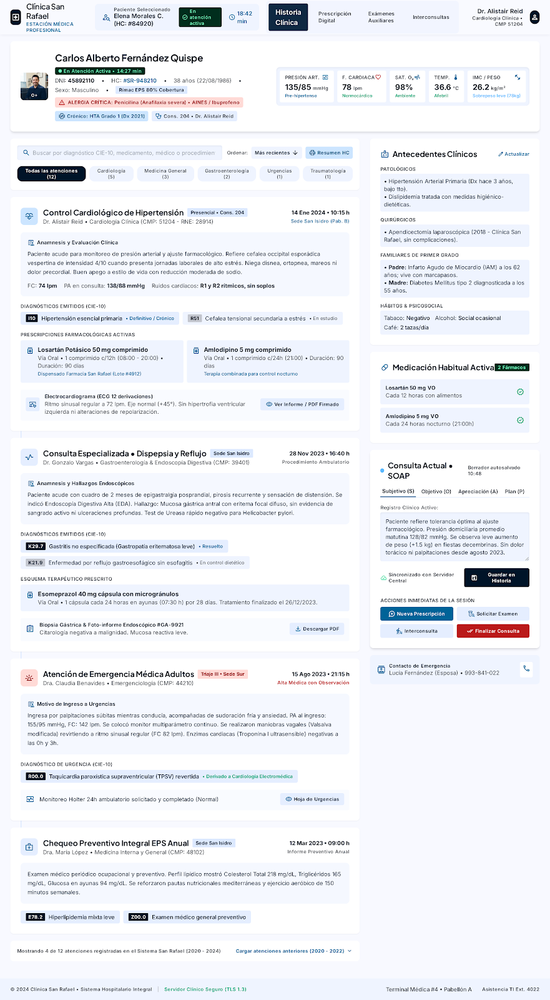

# UNIVERSIDAD NACIONAL DE INGENIERÍA
## Facultad de Ingeniería Industrial y de Sistemas · Escuela de Ingeniería de Software
### TALLER DE INGENIERÍA DE SOFTWARE I (SW705)

---

# PROYECTO INTEGRADOR — CASO CLÍNICA SAN RAFAEL S.A.C.
## ENTREGABLE 1: DOCUMENTACIÓN DE INGENIERÍA (SEMANAS 2 A 8)

* **Equipo:** E
* **Integrantes y roles:**
  * **Jhostin Leonardo Rodriguez Neyra** — *Scrum Master*
  * **Rafael Olivos Gallardo** — *Product Owner*
  * **Carlos Benjamin Fernandez Iquise** — *Developer*

---

## CONTEXTO DEL CASO — INFORMACIÓN DADA

### 0. Caso empresarial: Clínica San Rafael S.A.C.
Clínica privada de salud en San Borja, Lima, que ofrece consulta ambulatoria multiespecialidad, laboratorio, imágenes, farmacia, hospitalización, emergencia y cirugía ambulatoria. Gestiona historias clínicas en papel/Excel por especialidad, agenda telefónica saturada (18 % de inasistencia), resultados de laboratorio en papel (hasta 48 h de demora) y reconciliación manual con 5 EPS y aseguradoras.

### 0.1. Alcance funcional por módulos
| Módulo | Alcance funcional | Prioridad |
| :--- | :--- | :--- |
| **M1. Historia clínica electrónica (HCE)** | Registro unificado del paciente: antecedentes, consultas, diagnósticos (CIE-10), indicaciones y recetas | Sprint 1 *(imprescindible)* |
| **M2. Agenda y citas médicas** | Programación por especialidad y médico, confirmación/recordatorio, reprogramación, disponibilidad consolidada | Sprint 1 *(imprescindible)* |
| **M3. Laboratorio e imágenes** | Registro de órdenes médicas y resultados digitales | Sprint 2 *(imprescindible)* |
| **M4. Facturación y convenios** | Comprobantes, tarifario por convenio (particular/EPS/SOAT), copagos y glosas | Sprint 2 *(imprescindible)* |
| **M5. Reportes gerenciales** | Ocupación de consultorios, tiempos de espera, ingresos, inasistencia | Sprint 2 *(imprescindible)* |
| **M6. Portal del paciente / telemedicina** | Agendamiento en línea y consulta virtual básica | Sprint 2 *(deseable)* |

### 0.2. Requerimientos no funcionales mínimos
| RNF | Descripción |
| :--- | :--- |
| **Seguridad** | Acceso a la HCE restringido por rol y registrado en bitácora de auditoría (Ley N.° 29733). |
| **Disponibilidad** | Módulos de emergencia y agenda disponibles en horario de atención de la clínica. |
| **Rendimiento** | Apertura de la historia clínica en menos de 2 segundos, con hasta 8 000 pacientes. |
| **Trazabilidad** | Ninguna entrada de historia clínica se elimina físicamente; solo se anula con motivo. |
| **Usabilidad** | Interfaz simple para personal con distintos niveles de alfabetización digital. |

### 0.3. Restricciones
* Presupuesto de infraestructura acotado: hosting o nube de costo moderado.
* Toda prueba o demostración usa datos ficticios o anonimizados; nunca datos reales de pacientes.
* El equipo define y justifica el stack tecnológico en el documento de arquitectura.

---

## SEMANA 2 · AVANCE 1 — ACTA DE CONSTITUCIÓN Y DOCUMENTO DE VISIÓN

### 1. Acta de constitución del proyecto

#### 1.1. Datos generales
| Campo | Detalle |
| :--- | :--- |
| **Nombre del proyecto** | Sistema de Gestión de la Clínica San Rafael — SIGES SR |
| **Patrocinador** | Gerencia General, Clínica San Rafael S.A.C. |
| **Equipo** | E |
| **Fecha del acta** | 10/09/2026 |
| **Product Owner de referencia** | Docente del curso SW705 |

#### 1.2. Justificación del proyecto
Debido a que la gestión manual de la Clínica San Rafael provoca errores de medicación por historias dispersas y un 18 % de ausentismo en citas, el proyecto es indispensable. Su desarrollo unifica la historia clínica electrónica y la agenda médica automatizada, mitigando riesgos clínicos, reduciendo la inasistencia y habilitando la futura integración de laboratorio y facturación.

#### 1.3. Objetivos SMART
| N.° | Objetivo |
| :---: | :--- |
| **1** | Disminuir en un 90 % los errores de medicación asociados a falta de acceso al historial completo, medido por incidentes reportados, durante los primeros 3 meses posteriores al despliegue del HCE. |
| **2** | Implementar una HCE unificada que centralice antecedentes, consultas, diagnósticos (CIE-10) y recetas de todas las especialidades, logrando que el 100 % de los pacientes atendidos tengan una vista única de su historial al finalizar. |
| **3** | Disminuir el tiempo promedio para agendar una cita de 20 minutos (vía telefónica) a un máximo de 3 minutos mediante la agenda digital por especialidad y médico, medido a los 2 meses de implementado el módulo. |
| **4** | Reducir en un 95 % los casos de citas duplicadas o mal asignadas mediante la vista consolidada de disponibilidad, medido mensualmente durante el primer trimestre tras el despliegue. |

#### 1.4. Alcance resumido
* **Alcance M1 (HCE):** Registro unificado del paciente con antecedentes, consultas, diagnósticos CIE-10, indicaciones y recetas con acceso diferenciado por rol médico.
* **Alcance M2 (Agenda):** Programación de citas por especialidad y médico, confirmación y recordatorios (SMS/correo/WhatsApp), reprogramación, cancelación y vista consolidada de disponibilidad.
* *Ambos son parte del Sprint 1 (imprescindible).*

#### 1.5. Exclusiones
| N.° | Exclusión |
| :---: | :--- |
| **1** | No se desarrolla un call center ni un sistema de respuesta de voz interactiva (IVR). |
| **2** | No se incluye el intercambio de historiales clínicos con otras clínicas, hospitales o el sistema de salud público/privado externo a la organización. |
| **3** | No se realizará migración automatizada de historias clínicas reales de pacientes; solo se usarán datos de prueba ficticios o anonimizados representativos del caso. |
| **4** | No se incluye gestión de planillas, nómina ni recursos humanos del personal de la clínica. |
| **5** | No se integra el sistema con la Historia Clínica Electrónica Nacional (HCE-N) del MINSA. |
| **6** | No se cubre la gestión de hospitalización (censo de camas, altas y traslados) en el alcance de ningún sprint. |
| **7** | No se incluye un portal para proveedores o distribuidores de insumos médicos y farmacéuticos. |

#### 1.6. Supuestos y restricciones adicionales
| N.° | Supuesto / Restricción |
| :---: | :--- |
| **1** | El personal médico y administrativo cuenta con al menos un dispositivo (PC o tablet) con navegador actualizado para acceder al sistema. |
| **2** | La clínica cuenta con conexión a internet estable en admisión, consultorios y tópico de emergencia. |
| **3** | Los convenios vigentes con las 5 EPS/aseguradoras y SOAT no cambian sus condiciones contractuales durante el desarrollo del proyecto. |
| **4** | Se dispone de al menos una cuenta de nube o VPS de bajo costo para el despliegue del ambiente de desarrollo y demostración. |
| **5** | Un backup diario de la base de datos se considera suficiente para el nivel de criticidad del proyecto dado. |
| **6** | Los integrantes del equipo cuentan con conocimientos previos de Git y de un flujo de trabajo colaborativo (ramas, pull requests, Jira). |
| **7** | Las pruebas de usabilidad se realizan sobre navegadores actualizados (Chrome o Edge), sin soporte obligatorio para navegadores antiguos. |

#### 1.7. Riesgos iniciales
| Riesgo | Impacto | Mitigación |
| :--- | :---: | :--- |
| **Resistencia al cambio del personal médico y administrativo** acostumbrado al registro en papel/Excel. | Alto | Capacitación temprana, acompañamiento en el piloto y despliegue gradual por consultorio. |
| **Fuga o exposición de datos clínicos sensibles** durante el desarrollo o las demostraciones. | Alto | Uso exclusivo de datos ficticios/anonimizados, cifrado en tránsito y en reposo, control de acceso por rol y bitácora de auditoría (Ley N.° 29733). |
| **Subestimación del esfuerzo de integración con proveedores externos de notificación** (SMS/WhatsApp). | Medio | Prototipar temprano la integración con el proveedor elegido; definir plan B con notificación por correo electrónico. |
| **Caídas o indisponibilidad de la HCE durante la atención médica.** El sistema podría presentar interrupciones por problemas de conectividad o infraestructura. | Alto | Implementar respaldos periódicos, monitoreo de disponibilidad y mecanismos de recuperación del sistema. |

#### 1.8. Hitos principales
| Semana | Hito |
| :---: | :--- |
| **2** | Acta de constitución y documento de visión |
| **4** | Especificación de requerimientos, backlog y modelos UML |
| **6** | Arquitectura, modelo de base de datos y prototipo UX/UI |
| **7** | Plan de release y sprint backlog 1 |
| **8** | Examen Parcial — Sustentación del Entregable 1 |
| **16** | Examen Final — Sustentación del Entregable 2 (producto funcionando) |

---

### 2. Documento de visión

#### 2.1. Declaración de visión
> **Para** el personal clínico y administrativo de la Clínica San Rafael S.A.C.  
> **que** necesita de una vista única, oportuna y segura de la información clínica y de citas de sus pacientes,  
> **SIGES SR** es un sistema de información clínico-administrativo  
> **que** integra la historia clínica electrónica y la agenda multiespecialidad en una sola plataforma, con control de acceso por rol y trazabilidad completa;  
> **a diferencia de** los registros actuales hechos en papel y hojas de cálculo dispersos en cada consultorio  
> **que** fragmentan la información del paciente, generan errores de medicación y saturan la línea telefónica de citas.

#### 2.2. Perfiles de usuario (stakeholders)
| Perfil | Necesidad principal | Módulo relacionado |
| :--- | :--- | :---: |
| **Admisión / Recepción** | Registrar pacientes y programar citas rápidamente, sin duplicidad ni error de horario. | M1, M2 |
| **Médico tratante** | Acceder al historial completo del paciente para decidir diagnóstico y tratamiento con seguridad clínica. | M1 |
| **Enfermera** | Consultar antecedentes e indicaciones y registrar signos vitales previos a la consulta. | M1 |
| **Personal de laboratorio** | Visualizar órdenes médicas generadas en la consulta para procesarlas (alcance pleno en M3, Sprint 2). | M3 |
| **Cajero / Facturación** | Conocer el convenio del paciente y las citas atendidas para emitir el comprobante correcto. | M4 |
| **Gerencia médica** | Contar con indicadores de ocupación, tiempos de espera e inasistencia para tomar decisiones. | M5 |
| **Paciente** | Confirmar, reprogramar o cancelar su cita fácilmente y recibir recordatorios oportunos. | M1, M2 |

#### 2.3. Factibilidad
* **Técnica:** El proyecto es técnicamente factible porque puede desarrollarse mediante tecnologías web y una arquitectura modular, utilizando una base de datos centralizada para integrar la HCE, citas, resultados, farmacia y facturación. El desarrollo incremental mediante los módulos priorizados del Sprint 1 permite validar progresivamente las funcionalidades y realizar integraciones sin requerir la implementación completa del sistema desde el inicio.
* **Operativa:** El proyecto es operativamente factible porque responde a problemas actuales de la clínica, como la fragmentación de historias clínicas, la gestión telefónica de citas y la entrega tardía de resultados. La implementación gradual y la capacitación del personal facilitarán la adaptación al nuevo sistema sin afectar significativamente la atención.
* **Económica:** El proyecto es económicamente factible porque la inversión en digitalización puede compensarse mediante la reducción de errores, duplicidad de citas, inasistencias, glosas y tiempos administrativos. Además, la implementación por etapas permite distribuir los costos y priorizar las funcionalidades con mayor impacto en la atención y gestión.

---

## SEMANAS 3–4 · AVANCE 2 — ESPECIFICACIÓN DE REQUERIMIENTOS, BACKLOG Y MODELOS UML

### 3. Especificación de requerimientos (ERS)

#### 3.1. Requerimientos funcionales
| ID | Descripción | Módulo | Prioridad |
| :---: | :--- | :---: | :---: |
| **RF01** | El sistema debe registrar el perfil clínico del paciente (datos generales, antecedentes, alergias y enfermedades crónicas) en una única historia accesible desde cualquier especialidad, impidiendo registrar dos pacientes con el mismo número de documento de identidad. | M1 | Must |
| **RF02** | El sistema debe permitir registrar una consulta médica con diagnóstico codificado en CIE-10, indicaciones y receta asociados al episodio de atención. | M1 | Must |
| **RF03** | El sistema debe mostrar la historia clínica de un paciente de forma unificada y ordenada cronológicamente, sin importar la especialidad que registró cada entrada. | M1 | Must |
| **RF04** | El sistema debe permitir al médico tratante anular una entrada de la historia clínica, solicitándole el motivo de la anulación y registrando automáticamente quién la anuló y cuándo. La entrada anulada debe seguir visible en la historia clínica, identificada como anulada, junto con su motivo. | M1 | Must |
| **RF05** | El sistema debe permitir registrar una cita médica indicando paciente, médico, especialidad, fecha/hora y motivo de consulta, validando la disponibilidad consolidada del médico. | M2 | Must |
| **RF06** | El sistema debe enviar una confirmación y un recordatorio automático (SMS, correo y/o WhatsApp) al paciente antes de la fecha de su cita. | M2 | Must |
| **RF07** | El sistema debe permitir reprogramar o cancelar una cita registrada, liberando automáticamente el horario de la agenda consolidada para otros pacientes. | M2 | Must |
| **RF08** | El sistema debe permitir buscar a un paciente ya registrado por su DNI o nombre y recuperar su historia clínica existente, evitando volver a solicitar sus datos generales en cada visita. | M1 | Must |
| **RF09** | El sistema debe restringir la edición de la historia clínica al médico tratante y permitir solo lectura y registro de signos vitales al personal de enfermería. | M1 | Must |
| **RF10** | El sistema debe permitir generar, desde la consulta médica, una orden de laboratorio o de imágenes asociada al episodio de atención visible para el personal de laboratorio. | M1, M3 | Should |
| **RF11** | El sistema debe mostrar en la pantalla de cobro el tipo de convenio del paciente (particular, EPS o SOAT) asociado a la cita atendida, para emitir el comprobante correspondiente. | M2, M4 | Should |
| **RF12** | El sistema debe generar un reporte de ocupación de consultorios, tiempos de espera e inasistencia por especialidad y rango de fechas. | M2, M5 | Could |
| **RF13** | El sistema debe permitir al paciente agendar una cita en línea desde un portal, sujeta a la misma validación de disponibilidad consolidada usada en admisión. | M6 | Could |

#### 3.2. Requerimientos no funcionales
| ID | Descripción | Atributo | Verificación |
| :---: | :--- | :--- | :--- |
| **RNF01** | La historia clínica de un paciente debe abrirse en menos de 2 segundos, con una base de hasta 8 000 pacientes registrados. | Rendimiento | Prueba de carga simulando 8 000 pacientes, midiendo el tiempo de respuesta del endpoint de consulta de historia clínica en al menos 20 repeticiones. |
| **RNF02** | El acceso a la historia clínica debe estar restringido por rol (admisión, médico, enfermería, gerencia) y cada acceso debe quedar registrado en una bitácora de auditoría, conforme a la Ley N.° 29733. | Seguridad | Revisión de la matriz de permisos por rol y prueba de intento de acceso no autorizado; verificación de que cada consulta o edición queda registrada con usuario, fecha y acción. |
| **RNF03** | Los módulos de agenda y emergencia deben estar disponibles durante todo el horario de atención de la clínica, con una indisponibilidad no planificada menor a 1 %. | Disponibilidad | Monitoreo del uptime del servicio durante el horario de atención mediante un servicio de verificación periódica (health-check), con registro de incidentes. |
| **RNF04** | La interfaz de registro de citas e historia clínica debe permitir que un usuario de admisión sin experiencia previa complete el flujo de agendamiento sin soporte técnico. | Usabilidad | Prueba de usabilidad con 3 usuarios representativos (bajo, medio y alto nivel de alfabetización digital), midiendo tasa de éxito y número de errores en la tarea. |
| **RNF05** | Toda comunicación entre el navegador y el servidor, así como los datos clínicos almacenados, deben viajar y guardarse cifrados. | Seguridad | Inspección del tráfico (HTTPS/TLS) con herramientas de red y verificación de cifrado en la base de datos (at-rest) sobre un registro de prueba. |
| **RNF06** | El sistema debe realizar un respaldo (backup) diario automático de la base de datos, permitiendo restaurar la información al último punto guardado en caso de falla. | Disponibilidad | Prueba de restauración de un backup en un ambiente de prueba, verificando la integridad de los datos restaurados. |

---

### 3.3. Historias de usuario (con criterios de aceptación INVEST)

#### **HU01 (5 pts)**: Agendar cita con disponibilidad consolidada
* **Historia:** Como personal de admisión, quiero agendar una cita consultando la disponibilidad consolidada por especialidad y médico, para evitar citas duplicadas o mal asignadas.
* **Criterio de Aceptación:**
  * *Dado* que el médico tiene un horario disponible el día solicitado, *cuando* registro la cita indicando paciente, especialidad y horario, *entonces* el sistema confirma la reserva y bloquea ese horario para otros usuarios.
* **Cumplimiento INVEST:** Se puede construir y probar por sí sola (I); validación por bloqueo negociable (N); resuelve citas duplicadas (V); estimable en 5 pts por disponibilidad consolidada (E); cabe en un sprint y es testeable con Gherkin (S/T).

#### **HU02 (3 pts)**: Recordatorio automático de cita
* **Historia:** Como paciente, quiero recibir un recordatorio automático de mi cita por SMS o correo electrónico, para no olvidarla y reducir la inasistencia.
* **Criterio de Aceptación:**
  * *Dado* que tengo una cita programada, *cuando* faltan 24 horas para la fecha de la cita, *entonces* recibo un recordatorio automático con la fecha, hora y especialidad.
* **Cumplimiento INVEST:** Independiente (I); canal de envío negociable (N); reduce el 18 % de ausentismo (V); 3 pts por automatización con worker (E); pequeña y testeable (S/T).

#### **HU03 (8 pts)**: Historia clínica unificada
* **Historia:** Como médico, quiero ver la historia clínica unificada de un paciente, para conocer su historial completo antes de atenderlo, sin importar qué especialidad lo atendió antes.
* **Criterio de Aceptación:**
  * *Dado* un paciente con consultas registradas en más de una especialidad, *cuando* abro su historia clínica, *entonces* veo todas las entradas (antecedentes, diagnósticos, indicaciones) ordenadas cronológicamente.
* **Cumplimiento INVEST:** Independiente tras existir pacientes y consultas (I); campos visuales negociables (N); valor máximo por evitar errores de medicación (V); 8 pts por consolidación multidominio (E); testeable (S/T).

#### **HU04 (5 pts)**: Consulta de antecedentes e indicaciones
* **Historia:** Como enfermera, quiero consultar los antecedentes e indicaciones del paciente antes de la consulta, para registrar sus signos vitales con el contexto clínico adecuado.
* **Criterio de Aceptación:**
  * *Dado* que un paciente tiene una cita programada para hoy, *cuando* abro su ficha desde la agenda del día, *entonces* visualizo sus antecedentes y las indicaciones registradas en su última consulta.
* **Cumplimiento INVEST:** Independiente (I); vista negociable (N); evita repreguntas innecesarias al paciente (V); 5 pts por ser vista contextual (E); pequeña y testeable (S/T).

#### **HU05 (3 pts)**: Reprogramar o cancelar cita
* **Historia:** Como personal de admisión, quiero reprogramar o cancelar una cita existente, para liberar el horario y que otro paciente pueda tomarlo.
* **Criterio de Aceptación:**
  * *Dado* que una cita está registrada y aún no ha sido atendida, *cuando* el paciente solicita el cambio o la cancelación, *entonces* el sistema actualiza el estado de la cita y libera el horario en la agenda consolidada.
* **Cumplimiento INVEST:** Reutiliza lógica de agenda (I); confirmaciones negociables (N); libera capacidad ociosa (V); 3 pts (E); testeable (S/T).

#### **HU06 (3 pts)**: Registrar perfil clínico único del paciente
* **Historia:** Como personal de admisión, quiero registrar un perfil clínico único del paciente (datos generales, antecedentes, alergias y enfermedades crónicas), para evitar historias duplicadas.
* **Criterio de Aceptación:**
  * *Dado* que ya existe un paciente con un número de documento, *cuando* intento registrar otro con el mismo documento, *entonces* el sistema rechaza el registro e indica el paciente existente.
* **Cumplimiento INVEST:** Base del sistema (I); catálogo de alergias negociable (N); elimina historias fragmentadas (V); 3 pts por validación UNIQUE (E); testeable (S/T).

#### **HU07 (3 pts)**: Buscar paciente por DNI o nombre y abrir ficha
* **Historia:** Como personal de admisión, quiero buscar al paciente por DNI o nombre y abrir su ficha, para no volver a pedirle sus datos.
* **Criterio de Aceptación:**
  * *Dado* que el paciente está registrado, *cuando* busco por DNI o parte del nombre, *entonces* el sistema muestra las coincidencias y, al elegir una, abre su historia sin pedir los datos nuevamente.
* **Cumplimiento INVEST:** Independiente (I); búsqueda parcial negociable (N); agiliza atención (V); 3 pts sobre índices (E); testeable (S/T).

#### **HU08 (8 pts)**: Registrar consulta con diagnóstico CIE-10, indicaciones y receta
* **Historia:** Como médico tratante, quiero registrar la consulta con diagnóstico CIE-10, indicaciones y receta, para dejar documentado el episodio de atención.
* **Criterio de Aceptación:**
  * *Dado* un paciente en atención, *cuando* registro la consulta con al menos un diagnóstico CIE-10, *entonces* la consulta queda asociada al episodio con mi usuario y la fecha, y aparece en la historia del paciente.
* **Cumplimiento INVEST:** Independiente (I); formato de receta negociable (N); núcleo del valor asistencial (V); 8 pts por catálogo CIE-10 y 3 entidades hijas (E); testeable (S/T).

#### **HU09 (3 pts)**: Anular entrada de historia clínica con motivo
* **Historia:** Como médico tratante, quiero anular una entrada de la historia indicando el motivo, para corregir errores sin perder la evidencia.
* **Criterio de Aceptación:**
  * *Dado* que existe una entrada de la historia clínica, *cuando* la anulo indicando el motivo, *entonces* queda en estado “anulado” con el motivo y mi usuario, y el intento de eliminarla físicamente es rechazado.
* **Cumplimiento INVEST:** Independiente (I); formato tachado negociable (N); respaldo médico-legal (V); 3 pts por borrado lógico (E); testeable (S/T).

#### **HU10 (3 pts)**: Registrar signos vitales del paciente
* **Historia:** Como enfermera, quiero registrar los signos vitales del paciente, para dejar la información lista antes de la consulta, sin poder modificar lo registrado por el médico.
* **Criterio de Aceptación:**
  * *Dado* un paciente con cita hoy, *cuando* registro sus signos vitales, *entonces* quedan guardados con mi usuario y fecha; y si intento editar un diagnóstico, el sistema me lo deniega.
* **Cumplimiento INVEST:** Independiente (I); campos de signos negociables (N); preparación clínica segura (V); 3 pts (E); testeable (S/T).

#### **HU11 (3 pts)**: Confirmación de cita registrada, reprogramada o cancelada
* **Historia:** Como paciente, quiero recibir una confirmación al registrar, reprogramar o cancelar mi cita, para tener certeza de la fecha, hora y médico.
* **Criterio de Aceptación:**
  * *Dado* que se registró, reprogramó o canceló mi cita, *cuando* la operación termina, *entonces* recibo un mensaje con la fecha, hora, médico y especialidad.
* **Cumplimiento INVEST:** Independiente (I); canal negociable (N); certeza al paciente (V); 3 pts reutilizando cola (E); testeable (S/T).

#### **HU12 (5 pts)**: Generar órdenes de laboratorio o imágenes desde la consulta
* **Historia:** Como médico, quiero generar órdenes de laboratorio o imágenes desde la consulta, para que el laboratorio las reciba sin papel.
* **Criterio de Aceptación:**
  * *Dado* una consulta en curso, *cuando* genero una orden con los estudios solicitados, *entonces* la orden aparece en la bandeja del laboratorio con estado “pendiente”.
* **Cumplimiento INVEST:** Sprint 2; 5 pts; testeable con bandeja digital.

#### **HU13 (5 pts)**: Registrar resultado digital de orden de laboratorio o imágenes
* **Historia:** Como personal de laboratorio, quiero registrar el resultado digital de una orden, para que el médico lo consulte sin esperar hasta 48 horas.
* **Criterio de Aceptación:**
  * *Dado* una orden pendiente, *cuando* registro el resultado, *entonces* la orden pasa a “completada” y el médico lo ve en la historia del paciente.
* **Cumplimiento INVEST:** Sprint 2; 5 pts; elimina demoras de 48 h.

#### **HU14 (5 pts)**: Visualizar convenio y tarifa del paciente en cobro
* **Historia:** Como cajero, quiero ver el convenio del paciente (particular, EPS o SOAT) en la pantalla de cobro, para aplicar la tarifa correcta.
* **Criterio de Aceptación:**
  * *Dado* un paciente atendido, *cuando* abro el cobro, *entonces* el sistema muestra su convenio y la tarifa asociada sin que yo tenga que buscarla.
* **Cumplimiento INVEST:** Sprint 2; 5 pts; reduce glosas y errores.

#### **HU15 (5 pts)**: Consultar ocupación, tiempos de espera e inasistencia
* **Historia:** Como gerencia médica, quiero consultar la ocupación de consultorios, los tiempos de espera y la inasistencia por especialidad y fechas, para tomar decisiones de gestión.
* **Criterio de Aceptación:**
  * *Dado* que existen datos de citas en un rango de fechas, *cuando* aplico el filtro por especialidad, *entonces* veo los indicadores calculados para ese filtro.
* **Cumplimiento INVEST:** Sprint 2; 5 pts; analítica de gestión.

#### **HU16 (5 pts)**: Agendar cita desde el portal en línea
* **Historia:** Como paciente, quiero agendar mi cita desde el portal en línea, para no depender de la línea telefónica saturada.
* **Criterio de Aceptación:**
  * *Dado* que el médico tiene un horario libre, *cuando* lo reservo desde el portal, *entonces* el sistema aplica la misma validación de disponibilidad que usa admisión y bloquea el horario.
* **Cumplimiento INVEST:** Sprint 2; 5 pts; autoservicio.

#### **HU17 (8 pts)**: Control de acceso por rol y auditoría de historia clínica (Ley 29733)
* **Historia:** Como gerencia, quiero que cada rol acceda solo a lo que le corresponde y que toda lectura o edición de la historia clínica quede registrada, para cumplir la Ley N.° 29733.
* **Criterio de Aceptación:**
  * *Dado* un usuario con rol de admisión, *cuando* intenta editar una consulta, *entonces* el sistema rechaza la acción y la registra con usuario, fecha y acción.
* **Cumplimiento INVEST:** Sprint 1; transversal; 8 pts por matriz RBAC y bitácora de auditoría inmutable; testeable.

#### **HU18 (3 pts)**: Respaldo diario automático y restauración de historias clínicas
* **Historia:** Como responsable de TI, quiero un respaldo diario automático con restauración comprobada, para no perder historias clínicas ante una falla.
* **Criterio de Aceptación:**
  * *Dado* que ocurrió una falla en el ambiente de prueba, *cuando* restauro el último respaldo, *entonces* la base queda con los datos de la última copia (pérdida máxima de 24 horas).
* **Cumplimiento INVEST:** Sprint 1; transversal; 3 pts por automatización y verificación de restauración; testeable.

---

### 3.4. Product backlog priorizado (MoSCoW)
| ID | Historia (resumen) | Módulo | Sprint | Prioridad | Puntos |
| :---: | :--- | :---: | :---: | :---: | :---: |
| **HU01** | Agendar cita con disponibilidad consolidada | M2 | Sprint 1 | Must | 5 |
| **HU02** | Recordatorio automático de cita | M2 | Sprint 1 | Must | 3 |
| **HU03** | Historia clínica unificada | M1 | Sprint 1 | Must | 8 |
| **HU04** | Consulta de antecedentes e indicaciones | M1 | Sprint 1 | Must | 5 |
| **HU05** | Reprogramar o cancelar cita | M2 | Sprint 1 | Must | 3 |
| **HU06** | Registrar perfil clínico único del paciente | M1 | Sprint 1 | Must | 3 |
| **HU07** | Buscar paciente por DNI o nombre y abrir ficha | M1 | Sprint 1 | Must | 3 |
| **HU08** | Registrar consulta con diagnóstico CIE-10, indicaciones y receta | M1 | Sprint 1 | Must | 8 |
| **HU09** | Anular entrada de historia clínica con motivo | M1 | Sprint 1 | Must | 3 |
| **HU10** | Registrar signos vitales del paciente | M1 | Sprint 1 | Must | 3 |
| **HU11** | Confirmación de cita registrada, reprogramada o cancelada | M2 | Sprint 1 | Must | 3 |
| **HU17** | Control de acceso por rol y auditoría de historia clínica (Ley 29733) | M1/Transv. | Sprint 1 | Must | 8 |
| **HU18** | Respaldo diario automático y restauración de historias clínicas | M1/Transv. | Sprint 1 | Must | 3 |
| **HU12** | Generar órdenes de laboratorio o imágenes desde la consulta | M3 | Sprint 2 | Should | 5 |
| **HU13** | Registrar resultado digital de orden de laboratorio o imágenes | M3 | Sprint 2 | Should | 5 |
| **HU14** | Visualizar convenio y tarifa del paciente en cobro | M4 | Sprint 2 | Should | 5 |
| **HU15** | Consultar ocupación, tiempos de espera e inasistencia | M5 | Sprint 2 | Could | 5 |
| **HU16** | Agendar cita desde el portal en línea | M6 | Sprint 2 | Could | 5 |

---

### 4. Modelos UML

#### 4.1. Diagrama de casos de uso


*Descripción:* Este diagrama muestra quién usa el sistema y qué puede hacer cada uno: admisión registra pacientes y gestiona citas, el médico atiende y documenta la historia clínica, la enfermera registra signos vitales, laboratorio sube resultados, el cajero cobra según el convenio, gerencia revisa reportes y controla accesos, TI respalda la base de datos, y el paciente agenda desde el portal y recibe confirmaciones y recordatorios automáticos.

#### 4.2. Diagrama de clases de análisis


*Descripción:* Entidades centrales del dominio clínico-administrativo: `Usuario`, `Paciente`, `Médico`, `Especialidad`, `Cita`, `Consulta`, `Diagnóstico`, `Indicación`, `Receta`, `OrdenEstudio`, `Resultado` y `Comprobante`.

#### 4.3. Diagrama de actividades


*Descripción:* El flujo empieza cuando admisión busca o registra al paciente, elige especialidad y médico, y el sistema valida la disponibilidad antes de confirmar y bloquear el horario. Al agendar, se envía la confirmación de inmediato y, 24 horas antes, el recordatorio automático. El día de la cita, enfermería revisa antecedentes y registra signos vitales; luego el médico abre la historia clínica unificada, atiende al paciente, registra el diagnóstico CIE-10 con indicaciones y receta, y genera una orden de laboratorio o imágenes si la consulta lo requiere.

---

## SEMANAS 5–6 · AVANCE 3 — ARQUITECTURA, BASE DE DATOS Y PROTOTIPO UX/UI

### 5. Documento de arquitectura de software (SAD)

Las vistas y el stack describen la arquitectura objetivo. Swagger, colas de notificaciones, proxy y GitHub Actions aún están pendientes; las pruebas implementadas utilizan Vitest y Supertest.

#### 5.1. Estilo arquitectónico
Se elige la **arquitectura en capas con API REST monolítica modular** porque:
1. **Escala del problema:** La clínica es una sola sede con hasta 8 000 pacientes (RNF01). No existe hoy una necesidad real de escalar o desplegar los módulos de forma independiente, que es lo único que justifica el costo operacional y de red de los microservicios.
2. **Integridad de las reglas clínicas:** Varios requisitos Must dependen de operaciones consistentes dentro de una sola transacción: no duplicar DNI (RF01), anular en vez de eliminar (RF04, RNF02), validar disponibilidad consolidada al agendar y liberar el horario al reprogramar o cancelar (RF05, RF07). En un monolito con una sola base de datos esto se resuelve con transacciones ACID normales; en microservicios exigiría patrones complejos (sagas, consistencia eventual) en un dominio médico donde un error afecta la vida del paciente.
3. **Seguridad y cumplimiento centralizados:** Con una sola API, el control de acceso por rol y la bitácora de auditoría (RNF02), junto con el cifrado en tránsito y en reposo (RNF05), se implementan una vez en una capa transversal, en lugar de replicarlos y auditarlos en múltiples microservicios, reduciendo el riesgo frente a la Ley N.° 29733.

#### Diagramas de Arquitectura (Modelo C4)

* **Diagrama de Contexto (C4 Nivel 1):**


* **Diagrama de Contenedores (C4 Nivel 2):**


* **Diagrama de Componentes Frontend (C4 Nivel 3 - SPA):**


* **Diagrama de Componentes Backend (C4 Nivel 3 - API):**


---

#### 5.2. Vistas 4+1 (simplificadas)
| Vista | Contenido |
| :--- | :--- |
| **Lógica** | Monolito modular con cinco módulos en el backend: historia clínica (M1), agenda y citas (M2), laboratorio e imágenes (M3), facturación y convenios (M4) y reportes gerenciales (M5). El portal del paciente (M6) está en el frontend, junto a la interfaz del personal. Control de acceso, validación y auditoría atienden todas las peticiones. Las entidades centrales son paciente, médico, consulta (que se anula, nunca se borra), cita, orden con sus estudios y resultados, y comprobante. |
| **Procesos** | Toda petición pasa por el control de acceso, luego la validación y después el módulo; la auditoría registra lo ocurrido. Los recordatorios de citas salen por un worker aparte con cola y reintentos, así que si el proveedor falla, la agenda sigue. Las reglas delicadas (anular una consulta con motivo y responsable, evitar que dos pacientes tomen el mismo horario de un médico) se resuelven con transacciones y restricciones en PostgreSQL. Reportes solo lee. |
| **Desarrollo** | Un repositorio en GitHub con backend (NestJS, un módulo por cada M1 a M5) y frontend (React con Vite, incluye el portal M6). Los módulos no leen las tablas de otro módulo; se piden datos por servicios. Ramas por módulo, pull requests y GitHub Actions corriendo Vitest y Supertest en cada commit. |
| **Física** | Una máquina virtual en la nube (plan gratuito o de estudiante, o Render/Railway en nivel gratuito) con Docker Compose y cuatro contenedores: Nginx, API, worker y PostgreSQL. Un cron saca copias con pg_dump y las sube cifradas a la nube; UptimeRobot vigila /health. Solo se conecta hacia afuera con el proveedor de mensajería. |
| **Escenarios** | El médico anula una consulta con motivo y responsable; enfermería intenta editar la historia y se le niega; dos personas piden el mismo horario del mismo médico y solo una lo consigue; el paciente agenda una cita en línea y recibe su recordatorio aunque el proveedor falle; gerencia pide un reporte con 8 000 pacientes y responde en tiempo; se restaura un respaldo y los datos vuelven completos. |

---

#### 5.3. Decisiones de arquitectura (ADR)

* **ADR-1: Arquitectura en capas con API REST monolítica modular.**
  * *Decisión:* Arquitectura en capas (presentación, lógica de negocio, acceso a datos) con API REST monolítica, organizada internamente en módulos M1-M6 que se comunican solo por interfaces de servicio.
  * *Justificación:* Ofrece una sola unidad de despliegue, mantiene transacciones ACID entre módulos, implementa la seguridad y auditoría de forma transversal y facilita probar los RNF sobre un único sistema.
* **ADR-2: Base de datos relacional única (PostgreSQL).**
  * *Decisión:* Una única base de datos relacional (PostgreSQL), con esquemas lógicos separados por módulo, restricción UNIQUE sobre documento, claves foráneas e índices por DNI, paciente y fecha.
  * *Justificación:* Integridad referencial y transacciones ACID que garantizan las reglas clínicas, restricciones declarativas, alto rendimiento con 8 000 pacientes mediante índices, soporte nativo de cifrado y backups programados (RNF06).
* **ADR-3: Borrado lógico y bitácora de auditoría inmutable.**
  * *Decisión:* Las entradas de HCE tienen estado activo/anulado, con motivo y usuario obligatorios al anular. La API no expone operaciones DELETE sobre HCE y el usuario de BD no tiene permisos DELETE. Tabla de bitácora append-only.
  * *Justificación:* Cumple RF04 y la Ley N.° 29733 (RNF02). Garantiza trazabilidad médico-legal completa y verificación simple: intentar borrar y comprobar que solo cambia el estado con datos del responsable.
* **ADR-4: RBAC validado en el servidor.**
  * *Decisión:* Matriz de permisos rol-acción-recurso aplicada en middleware/guards antes de la lógica de negocio. Tokens JWT de corta duración, contraseñas con hash salteado (bcrypt/argon2) y tráfico HTTPS/TLS.
  * *Justificación:* Único punto de control y auditoría, matriz verificable y protección contra llamadas directas a la API.
* **ADR-5: Envío asíncrono de notificaciones.**
  * *Decisión:* Notificaciones encoladas (BullMQ). Un worker procesa los envíos con reintentos y adaptador intercambiable (correo, SMS, WhatsApp).
  * *Justificación:* Si el proveedor externo falla, la agenda sigue funcionando (protege RNF03). Mensajes desacoplados con mínimo de datos clínicos por privacidad.

---

#### 5.4. Atributos de calidad y soporte arquitectónico
* **Seguridad (RNF02, RNF05):** Matriz RBAC con 4 roles; 100 % de accesos no autorizados rechazados. Auditoría append-only con usuario, fecha y acción. Cifrado TLS en tránsito y at-rest en base de datos.
* **Rendimiento (RNF01):** Apertura de HCE en < 2 segundos con 8 000 pacientes, validado con índices en PostgreSQL y pruebas de carga con percentil 95 < 2 s.
* **Disponibilidad (RNF03, RNF06):** Uptime > 99 % en horario de atención con health-check periódico. Backup diario automático (`pg_dump`) con restauración comprobada (RPO máximo de 24 h).
* **Usabilidad (RNF04):** Flujo de agendamiento intuitivo, probado con 3 perfiles de usuario distintos, logrando 100 % de éxito sin soporte técnico.
* **Modificabilidad:** Módulos desacoplados que solo interactúan mediante interfaces de servicio, facilitando la incorporación de M3-M6 sin alterar M1 y M2.

---

#### 5.5. Stack tecnológico
| Capa | Tecnología | Justificación |
| :--- | :--- | :--- |
| **Lenguaje** | Node.js con TypeScript | Un solo lenguaje en backend y frontend, tipado estático y curva de aprendizaje baja. |
| **Framework backend** | NestJS | Arquitectura modular por capas out-of-the-box (controladores, servicios, repositorios). |
| **Base de datos** | PostgreSQL | Soporte ACID estricto, índices relacionales, JSONB y cifrado en reposo. |
| **Acceso a datos** | Prisma | Modelo declarativo, migraciones versionadas y consultas tipadas contra inyección SQL. |
| **Validación** | class-validator | Validación de DTOs (DNI, CIE-10, fechas) previa a la lógica de negocio. |
| **Seguridad** | JWT + bcrypt + NestJS Guards + Helmet | Implementación de RBAC en el servidor, contraseñas con sal y cabeceras HTTP seguras. |
| **Auditoría** | Interceptor NestJS | Registro transversal de cada operación sobre HCE en bitácora append-only. |
| **Frontend** | React con Vite + Tailwind CSS | SPA rápida, reactiva y componentes estilizados con alta usabilidad. |
| **Documentación** | Swagger (`@nestjs/swagger`) | Especificación OpenAPI viva y probador interactivo de endpoints. |
| **Proxy inverso** | Nginx | Terminación TLS/HTTPS y compresión de estáticos. |
| **Notificaciones** | BullMQ + Redis + Nodemailer | Desacoplamiento asíncrono y reintentos ante caídas del proveedor. |
| **Contenedores** | Docker + Docker Compose | Paridad absoluta entre entornos de desarrollo y producción. |
| **Hosting** | VPS / Nube (Render, Railway u Oracle Free Tier) | Ajustado a la restricción presupuestaria dada. |
| **Monitoreo** | Endpoint `/health` + UptimeRobot | Verificación continua de disponibilidad (RNF03). |
| **Pruebas** | Vitest + Supertest | Pruebas unitarias y de integración de endpoints. |
| **CI/CD** | GitHub + GitHub Actions | Pipeline automatizado de linting y testing por cada commit y PR. |

---

### 6. Modelo de base de datos

#### 6.1. Modelo entidad-relación (ER)


#### 6.2. Diccionario de datos (tablas principales)

##### Tabla: `usuario`
| Campo | Tipo | Nulo | Descripción |
| :--- | :--- | :---: | :--- |
| `id` | integer | NO | PK autoincremental |
| `rol` | rol_usuario (ENUM) | NO | Rol: admision, medico, enfermeria, laboratorio, cajero, gerencia, paciente |
| `username` | varchar(50) | NO | Nombre de usuario único para login |
| `password_hash` | varchar(255) | NO | Contraseña con hash salteado (bcrypt/argon2) |
| `nombres` | varchar(100) | NO | Nombres de la persona |
| `apellidos` | varchar(100) | NO | Apellidos de la persona |
| `activo` | boolean | NO | Cuenta habilitada (default: true) |
| `creado_en` | timestamptz | NO | Fecha y hora de creación del registro |

##### Tabla: `paciente`
| Campo | Tipo | Nulo | Descripción |
| :--- | :--- | :---: | :--- |
| `id` | integer | NO | PK autoincremental |
| `usuario_id` | integer | SI | FK → `usuario.id`. Cuenta opcional del portal (Sprint 2) |
| `nombres` | varchar(100) | NO | Nombres propios del paciente, sin requerir cuenta |
| `apellidos` | varchar(100) | NO | Apellidos del paciente |
| `tipo_documento` | varchar(12) | NO | DNI, CE o PASAPORTE |
| `numero_documento` | varchar(15) | NO | Número de documento (único con tipo_documento) |
| `fecha_nacimiento` | date | NO | Fecha de nacimiento |
| `sexo` | char(1) | NO | Sexo biológico: M o F |
| `telefono` | varchar(20) | NO | Teléfono de contacto |
| `correo` | varchar(120) | NO | Correo electrónico de contacto |
| `direccion` | varchar(200) | SI | Dirección domiciliaria |

##### Tabla: `medico`
| Campo | Tipo | Nulo | Descripción |
| :--- | :--- | :---: | :--- |
| `id` | integer | NO | PK autoincremental |
| `usuario_id` | integer | NO | FK → `usuario.id`. Datos personales del médico |
| `especialidad_id` | smallint | NO | FK → `especialidad.id` |
| `cmp` | varchar(10) | NO | Número de Colegio Médico del Perú (único) |

##### Tabla: `cita`
| Campo | Tipo | Nulo | Descripción |
| :--- | :--- | :---: | :--- |
| `id` | integer | NO | PK autoincremental |
| `paciente_id` | integer | NO | FK → `paciente.id` |
| `medico_id` | integer | NO | FK → `medico.id` |
| `fecha_hora_inicio` | timestamptz | NO | Inicio de la cita médica |
| `fecha_hora_fin` | timestamptz | NO | Fin de la cita (debe ser > inicio) |
| `motivo` | varchar(300) | SI | Motivo de consulta declarado |
| `estado` | varchar(15) | NO | programada / confirmada / reprogramada / cancelada / atendida / no_asistio |
| `canal_origen` | varchar(12) | NO | presencial / telefono / portal |
| `modalidad` | varchar(10) | NO | presencial / virtual |
| `enlace_virtual` | varchar(300) | SI | Enlace de videollamada (si modalidad = virtual) |
| `llegada_en` | timestamptz | SI | Hora de llegada a sala de espera |
| `creado_por` | integer | NO | FK → `usuario.id`. Quien registró la cita |
| `creado_en` | timestamptz | NO | Fecha de creación del registro |

##### Tabla: `consulta`
| Campo | Tipo | Nulo | Descripción |
| :--- | :--- | :---: | :--- |
| `id` | integer | NO | PK autoincremental |
| `paciente_id` | integer | NO | FK → `paciente.id` |
| `medico_id` | integer | NO | FK → `medico.id` |
| `cita_id` | integer | SI | FK → `cita.id` (único). Permite atención sin cita, sin ampliar el alcance a hospitalización |
| `fecha_hora` | timestamptz | NO | Fecha y hora de la atención |
| `motivo` | varchar(300) | NO | Motivo de la atención médica |
| `indicaciones` | text | SI | Indicaciones generales registradas |
| `estado` | varchar(10) | NO | activo / anulado |
| `motivo_anulacion` | varchar(300) | SI | Obligatorio si estado = anulado |
| `anulado_por` | integer | SI | FK → `usuario.id`. Obligatorio si estado = anulado |
| `anulado_en` | timestamptz | SI | Obligatorio si estado = anulado |

##### Tabla: `orden`
| Campo | Tipo | Nulo | Descripción |
| :--- | :--- | :---: | :--- |
| `id` | integer | NO | PK autoincremental |
| `consulta_id` | integer | NO | FK → `consulta.id` |
| `tipo` | varchar(12) | NO | laboratorio / imagenes |
| `solicitada_en` | timestamptz | NO | Fecha y hora de solicitud |

##### Tabla: `comprobante`
| Campo | Tipo | Nulo | Descripción |
| :--- | :--- | :---: | :--- |
| `id` | integer | NO | PK autoincremental |
| `cita_id` | integer | NO | FK → `cita.id` |
| `paciente_id` | integer | NO | FK → `paciente.id` |
| `convenio_id` | smallint | NO | FK → `convenio.id` (particular, EPS, SOAT) |
| `serie` | varchar(4) | NO | Serie del comprobante |
| `numero` | integer | NO | Número correlativo único |
| `total` | numeric(10,2) | NO | Monto total facturado |
| `copago` | numeric(10,2) | NO | Monto asumido por el paciente |
| `estado` | varchar(10) | NO | emitido / pagado / anulado |
| `emitido_por` | integer | NO | FK → `usuario.id` (cajero) |
| `emitido_en` | timestamptz | NO | Fecha y hora de emisión |
| `motivo_anulacion` | varchar(300) | SI | Obligatorio si estado = anulado |
| `anulado_por` | integer | SI | FK → `usuario.id` |
| `anulado_en` | timestamptz | SI | Fecha y hora de anulación |

---

#### 6.3. Script DDL (extracto relacional)

```sql
CREATE TABLE usuario (
    id            integer GENERATED BY DEFAULT AS IDENTITY PRIMARY KEY,
    rol           rol_usuario NOT NULL,
    username      varchar(50) NOT NULL UNIQUE,
    password_hash varchar(255) NOT NULL,
    nombres       varchar(100) NOT NULL,
    apellidos     varchar(100) NOT NULL,
    activo        boolean NOT NULL DEFAULT true,
    creado_en     timestamptz NOT NULL DEFAULT now()
);

CREATE TABLE consulta (
    id               integer GENERATED BY DEFAULT AS IDENTITY PRIMARY KEY,
    paciente_id      integer NOT NULL REFERENCES paciente(id),
    medico_id        integer NOT NULL REFERENCES medico(id),
    cita_id          integer UNIQUE REFERENCES cita(id),
    fecha_hora       timestamptz NOT NULL DEFAULT now(),
    motivo           varchar(300) NOT NULL,
    indicaciones     text,
    estado           varchar(10) NOT NULL DEFAULT 'activo'
                     CHECK (estado IN ('activo', 'anulado')),
    motivo_anulacion varchar(300),
    anulado_por      integer REFERENCES usuario(id),
    anulado_en       timestamptz,
    CONSTRAINT ck_consulta_anulacion CHECK (
        estado = 'activo'
        OR (motivo_anulacion IS NOT NULL AND length(btrim(motivo_anulacion)) > 0
            AND anulado_por IS NOT NULL AND anulado_en IS NOT NULL)
    )
);
```

---

### 7. Prototipo UX/UI

#### 7.1. Pantalla — Agendar citas por el recepcionista de manera presencial


*Descripción:* Responde a la necesidad de reducir el tiempo de agendamiento de más de 10 minutos a menos de 3 minutos. Muestra disponibilidad por médico y fecha. Flujo:
1. Búsqueda de paciente por DNI.
2. Selección de fecha de atención.
3. Selección de médico tratante.
4. Selección del turno disponible.
5. Confirmación del resumen de agendamiento.

#### 7.2. Pantalla — Recordatorio de cita en portal, correo y SMS


*Descripción:* Automatiza el recordatorio 24 h y 1 h antes de la cita, permitiendo al paciente confirmar asistencia 30 min antes para reducir el ausentismo del 18 %. Notificación enviada al portal del paciente, correo y SMS.

#### 7.3. Pantalla — Visualización de la HCE unificada por el médico


*Descripción:* Resuelve la fragmentación de historias clínicas en papel. El médico accede al historial completo: antecedentes, diagnósticos previos (CIE-10), indicaciones de otras especialidades, recetas activas y resultados de análisis.

#### 7.4. Flujo de navegación del portal (objetivo del Sprint 2)

Este flujo corresponde a HU16. La demostración del Sprint 1 usa admisión, enfermería y médico, sin exigir cuentas del portal para registrar pacientes.
| Paso | Descripción |
| :---: | :--- |
| **1** | El paciente accede al portal ingresando sus credenciales de usuario. |
| **2** | Visualiza el dashboard con atajos para agendar citas, ver HCE, sus 3 notificaciones recientes y su próxima cita. |
| **3** | Elige "Agendar nueva cita" y selecciona especialidad y fecha de atención. |
| **4** | Selecciona al médico tratante y el turno disponible en la agenda consolidada. |
| **5** | Revisa el resumen de agendamiento, confirma el importe estimado y envía la solicitud. |
| **6** | Admisión valida la disponibilidad en el sistema consolidado y aprueba la reserva. |
| **7** | El paciente recibe la confirmación y visualiza la cita programada en su portal. |

---

## SEMANA 7 · AVANCE 4 — PLAN DE RELEASE Y SPRINT BACKLOG 1

### 8. Plan de release

| Sprint | Semanas | Alcance funcional y técnico | Estimación |
| :---: | :---: | :--- | :---: |
| **Sprint 1** | Semanas 9 – 11 | **Módulos M1 y M2 completos, más historias transversales de seguridad y respaldo:**<br>• **M1 (HCE):** HU06 (perfil único), HU07 (búsqueda DNI/nombre), HU08 (consulta con CIE-10/receta), HU09 (anular con motivo), HU10 (signos vitales), HU04 (antecedentes e indicaciones), HU03 (HCE unificada).<br>• **M2 (Agenda) y Notificaciones:** HU01 (agendar con disponibilidad), HU05 (reprogramar/cancelar), HU02 (recordatorio 24h), HU11 (confirmación).<br>• **Transversales:** HU17 (RBAC y auditoría Ley 29733) y HU18 (respaldo y restauración).<br><br>*Objetivo:* Dejar operativo el flujo núcleo clínico (RF01–RF09) sin borrado físico y con trazabilidad completa. | **13 historias**<br>**58 puntos** |
| **Sprint 2** | Semanas 12 – 14 | **Módulos M3, M4, M5 y M6 completos:**<br>• **M3 (Laboratorio e imágenes):** HU12 (generar orden), HU13 (resultado digital).<br>• **M4 (Facturación y convenios):** HU14 (convenio y copago en cobro).<br>• **M5 (Reportes gerenciales):** HU15 (ocupación, esperas e inasistencia).<br>• **M6 (Portal del paciente):** HU16 (agendamiento en línea).<br><br>*Objetivo:* Eliminar el papel en laboratorio, visibilizar convenios en caja, métricas de gestión y canal de autoservicio. | **5 historias**<br>**25 puntos** |

---

### 9. Sprint backlog 1
| Historia | Descripción | Responsable | Puntos | Estado |
| :---: | :--- | :--- | :---: | :---: |
| **HU17** | Control de acceso por rol y auditoría de historia clínica (Ley 29733) | Jhostin Leonardo Rodríguez Neyra | 8 | Por hacer |
| **HU08** | Registrar consulta con diagnóstico CIE-10, indicaciones y receta | Jhostin Leonardo Rodríguez Neyra | 8 | Por hacer |
| **HU09** | Anular entrada de la historia clínica indicando el motivo | Jhostin Leonardo Rodríguez Neyra | 3 | Por hacer |
| **HU06** | Registrar un perfil clínico único del paciente (DNI único) | Rafael Olivos Gallardo | 3 | Por hacer |
| **HU07** | Buscar paciente por DNI o nombre y abrir ficha | Rafael Olivos Gallardo | 3 | Por hacer |
| **HU03** | Ver historia clínica unificada cronológica | Rafael Olivos Gallardo | 8 | Por hacer |
| **HU04** | Consultar antecedentes e indicaciones previas | Rafael Olivos Gallardo | 5 | Por hacer |
| **HU10** | Registrar signos vitales del paciente | Rafael Olivos Gallardo | 3 | Por hacer |
| **HU01** | Agendar cita consultando disponibilidad consolidada | Carlos Benjamin Fernandez Iquise | 5 | Por hacer |
| **HU05** | Reprogramar o cancelar una cita liberando horario | Carlos Benjamin Fernandez Iquise | 3 | Por hacer |
| **HU02** | Enviar recordatorio automático de cita 24h antes | Carlos Benjamin Fernandez Iquise | 3 | Por hacer |
| **HU11** | Enviar confirmación al registrar, reprogramar o cancelar | Carlos Benjamin Fernandez Iquise | 3 | Por hacer |
| **HU18** | Respaldo diario automático con restauración comprobada | Carlos Benjamin Fernandez Iquise | 3 | Por hacer |
| **TOTAL** | **13 historias de usuario priorizadas** | — | **58** | — |

#### 9.1. Definición de Hecho (Definition of Done)
1. **Criterios de Aceptación:** El código cumple los criterios Dado/Cuando/Entonces y fue revisado por al menos otro integrante mediante Pull Request en GitHub.
2. **Pruebas Automatizadas:** Pruebas unitarias o de integración con Vitest/Supertest pasando al 100 % sin errores.
3. **Reglas de Base de Datos e Integridad:** Cero borrado físico en HCE (solo anulación vía `ck_consulta_anulacion`), control RBAC activo y auditoría registrada en cada acceso.
4. **Integración Continua:** Código fusionado en rama principal sin fallas en el pipeline de GitHub Actions.
5. **Pruebas End-to-End en Contenedores:** Probado en ambiente Docker, verificando casos límite (DNI duplicado, colisión de horarios, anulación con motivo).
6. **Documentación:** Swagger actualizado y modelo relacional/DBML sincronizado con cualquier cambio de esquema. Swagger sigue pendiente y bloquea declarar historias terminadas.

---

### 9.2. Avance técnico al 27/10/2026

El total correcto del Sprint 1 es **58 puntos** (13 historias); la cifra anterior de 49 era un error de suma. El Sprint 2 conserva 25 puntos. Las estimaciones individuales no cambiaron.

| Área | Implementado | Pendiente para cerrar historias |
| :--- | :--- | :--- |
| Base técnica | Prisma integrado, configuración, prefijo `/api`, DTO, CORS y cierre de conexiones | Validación del equipo en contenedores y pipeline |
| HU17 | Login JWT, rol/estado consultados en cada petición, denegaciones auditadas y acceso clínico restringido | Integrar auditoría en futuras operaciones de HCE, matriz completa, revisión por PR |
| HU06 | API de registro con documento único, DNI de 8 dígitos, antecedentes (incluye crónicas) y alergias; paciente sin cuenta de portal | Interfaz de admisión, Swagger y DoD completa |
| HU07 | API de búsqueda por documento/nombres/apellidos y ficha demográfica; perfil clínico para médico/enfermería | Interfaz y apertura de HCE cronológica (HU03) |
| HU01/HU05 | Restricción PostgreSQL para intervalos válidos y evitar solapamientos de citas por médico. Modelo semanal de horarios por médico y consultorio, con duración configurable y protección contra cruces | API de disponibilidad, reservas/reprogramaciones/cancelaciones e interfaz |
| HU09 | CHECK de anulación y triggers contra DELETE/TRUNCATE de consultas | Endpoint de anulación, autorización e interfaz |

Todas las historias del backlog permanecen **Por hacer** como entregables completos; este avance técnico no acredita toda la Definition of Done. No se ha verificado el producto en contenedores ni existe pipeline de CI todavía.

**Persistencia implementada (actualizada al 28/10/2026):** `usuario`, `paciente`, `medico`, `especialidad`, `consultorio`, `horario_medico`, `cita`, `consulta`, `bitacora_auditoria`, `antecedente` y `alergia`. El DBML de semana 7 conserva las demás entidades como diseño objetivo. La fuente ejecutable es `apps/api/prisma/schema.prisma` más las migraciones SQL: Prisma no expresa los CHECK, triggers ni las exclusiones GiST. `consulta.cita_id` es opcional, conforme al DBML. Los nombres del paciente se guardan en `paciente` y el vínculo a `usuario` es opcional.

**Verificación reproducible:** `npm.cmd test`, `npm.cmd run test:e2e` y `npm.cmd run test:db` desde `apps/api`. Las pruebas de base de datos crean un esquema temporal único, aplican todas las migraciones y verifican duplicados, permisos, lectura clínica auditada, colisión concurrente, intervalos adyacentes, cancelación, anulación y bitácora append-only. No sustituyen la validación en contenedores ni la revisión por otro integrante.

**Avance de HU01 al 28/10/2026 (primera parte):** modelos `consultorio` y `horario_medico`, días ISO 1..7, horas locales de `America/Lima` y duración configurable (20 minutos por defecto). La migración impide intervalos inválidos y cruces semanales por médico o consultorio; permite bloques adyacentes. Horas en minutos completos, dentro del mismo día (00:00 a 23:59); vigencias y excepciones por fecha siguen fuera de este incremento. La disponibilidad deberá omitir cualquier resto del bloque que no alcance para una cita completa. Todavía no hay endpoints ni conexión de las citas con estos horarios.

**Próximo incremento de Carlos:** HU01, agregando datos ficticios de médicos, consultorios y horarios y exponiendo disponibilidad por especialidad/médico/fecha. Después, reserva transaccional con respuesta 409 ante colisión. HU05 reutilizará esa política; HU02/HU11 y HU18 siguen pendientes.

---

## SEMANA 8 · EXAMEN PARCIAL — GUION DE SUSTENTACIÓN DEL ENTREGABLE 1

### 10. Guion de sustentación (15 minutos)
| Tiempo | Sección | Quién expone | Enfoque clave |
| :---: | :--- | :--- | :--- |
| **2 min** | Problema y visión | Jhostin Leonardo Rodriguez Neyra | Situación actual, ausentismo (18 %), errores por papel, Objetivos SMART y Declaración de Visión. |
| **4 min** | Requerimientos y backlog | Rafael Olivos Gallardo | ERS (Must/Should), trazabilidad de historias INVEST, criterios Gherkin y priorización MoSCoW. |
| **6 min** | Arquitectura, diseño y prototipo | Carlos Benjamin Fernandez Iquise | Monolito modular en capas, C4 (Contexto a Componentes), ADRs, PostgreSQL con borrado lógico (Ley 29733) y prototipos UX/UI. |
| **3 min** | Plan de desarrollo y preguntas | Jhostin Leonardo Rodriguez Neyra | Plan de release (Sprint 1 vs 2), Sprint Backlog 1, DoD y cierre para ronda de preguntas del jurado. |
